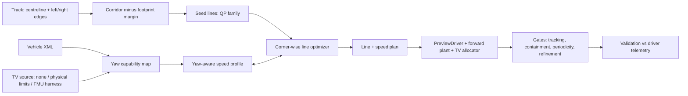

# Virtual-driver proposal v2: yaw-aware line planning

**Prepared:** 2026-10-25. **Status:** Proposal for review; nothing here is implemented. It supersedes the recommendation in §6 of the [methodology comparison](virtual-driver-methodology-comparison-2026-10-25.md). The comparison of the two reference papers is unchanged.
**Shelved companion:** [FMU yaw-capability harness plan](../superpowers/plans/2026-10-25-fmu-yaw-capability-harness.md). It plugs a real torque-vectoring (TV) controller into §4 later.

## 1. What changed from v1 and why

v1 proposed this pipeline:
- a geometric line (minimum-curvature QP, or the [P1] parametric blend);
- a point-mass speed profile;
- a preview tracker.

That pipeline cannot reflect a known driving fact: **TV cars prefer a more V-shaped line than non-TV cars.** The line shape is decided by how fast the car can *change* its yaw rate. v1 had no model of that anywhere:
- a minimum-curvature line ignores the vehicle;
- the point-mass speed profile has unlimited yaw authority;
- the existing min-time optimizer has fixed curvature-rate bounds that are the same for every car.

v2 keeps the decoupled, deterministic structure but adds one physical quantity throughout: **yaw-moment capability**.

| Layer | v1 | v2 |
|---|---|---|
| Vehicle capability | 2D table: speed, curvature → acceleration limits | 3D **yaw capability map**: speed, a_x, a_y → yaw-moment authority (into/out of turn), plus the yaw-balanced acceleration envelope. Built per car configuration (no-TV, physical TV limits, later the FMU) |
| Line | Minimum-curvature QP (or [P1] blend) as the final line | Corner-by-corner **lap-time optimization** of the lateral offset, evaluated with the yaw-aware profile. QP lines are used only as seeds |
| Speed | Point-mass forward/backward sweep | Same sweep, plus a **yaw constraint** that couples speed, a_x and the curvature rate |
| Tracking | `PreviewDriver` | `PreviewDriver`. The TV car gets a TV allocator in the plant |
| Human realism | [P1] blend as an option | [P1]-style offset kept only as an optional layer *on top of* the physics line, if validation shows a systematic gap |
| Min-time OCP | Offline benchmark | Unchanged. Can optionally take the same yaw constraint, so the benchmark is comparable |

## 2. The physics in one page

Take the path curvature κ(ℓ) of the line and the speed v(ℓ), and neglect the rate of change of sideslip. Then the yaw rate is r = v·κ, and the line demands a yaw acceleration of:

  ṙ = a_x·κ + v²·κ′,  where κ′ = dκ/dℓ

The car can deliver it only if:

  −M_out(v, a_x, a_y) ≤ sign(κ)·I_z·ṙ ≤ M_in(v, a_x, a_y),  with a_y = v²κ

- **M_in** is the largest yaw moment *into* the turn and **M_out** the largest yaw moment *out of* it. Both are ≥ 0.
- Both are the extremes of what the four tires (and motors) can produce **while also** delivering the total forces m·a_x + drag and m·a_y.
- Steady cornering is the special case ṙ = 0, so it needs 0 ∈ [−M_out, M_in]. Map A (the steady envelope) and map B (rotation capability) therefore come from the same calculation.

Why this produces a V for TV and a U for no-TV:
- **No-TV:** yaw moment comes only from shifting lateral force between the front and rear axles. That authority collapses as the axles saturate, and under heavy braking or traction. Large v²κ′ is expensive, so the optimizer spreads curvature out (U).
- **TV:** a left/right drive or regen torque difference adds yaw moment directly, even when combined with a_x. The optimizer can brake straight, rotate over a short arc, and exit straight (V).

Nothing is told to "make a V"; the shape comes out of the constraint.

## 3. Pipeline

## 4. Yaw capability map (Phase 1)

**Type:** `YawCapabilityMap`, in a new module `formulations/yaw_capability.py`. It is separate from the 2D `CapabilitySurface`, and can produce a 2D steady-envelope view of itself for existing consumers. Fields:
- grids: `speed`, `longitudinal_acceleration`, `lateral_acceleration`;
- `yaw_moment_into_turn`, `yaw_moment_out_of_turn`;
- `feasible_mask`, `yaw_inertia`;
- `source_kind`, `source_identity`. Kinds: `physical_no_tv_v1`, `physical_tv_v1`, and later `fmu_closed_loop_v1`.

**Physical source:** `build_physical_yaw_map(vehicle, grid, tv_limits) -> YawCapabilityMap`. Setting `tv_limits=None` gives no-TV, and `TvLimits(max_delta_torque, regen_vectoring_allowed, brake_vectoring_allowed, max_hydraulic_force_difference=0.0)` gives physical TV. The hydraulic parameter is a finite nonnegative left/right wheel-force difference in N, independent of motor torque. It solves one small LP per grid cell and direction (SciPy HiGHS). For a fixed (v, a_x, a_y):

- **Variables:** the four longitudinal forces, plus front and rear axle lateral forces. Each axle's lateral force is shared between left and right in proportion to load, like the existing point-mass allocation. The LP therefore does not get a free left/right lateral split it couldn't realize.
- **Loads:** from the existing `normal_loads(vehicle, v, a_x, a_y)`.
- **Constraints:**
  - force balance: ΣF_x = m·a_x + drag(v), ΣF_y = m·a_y;
  - each tire's friction circle as a 16-sided polygon of the existing tire capacities;
  - drive only on driven wheels;
  - motor torque and power limits from the existing powertrain envelope;
  - brake bias.
- **Configuration constraints:**
  - **No-TV:** equal left/right drive torque, and the fixed brake bias split equally left/right.
  - **Physical TV:** left/right motor drive force difference is bounded by `max_delta_torque / effective_tire_radius`; `regen_vectoring_allowed` controls regen vectoring; hydraulic left/right wheel-force difference is independently bounded by `max_hydraulic_force_difference` (N) only when `brake_vectoring_allowed`. The hydraulic limit defaults to 0.0, so enabling brake vectoring alone grants no differential authority. These are explicit parameters, set to represent the *algorithm's* authority. The ideal unconstrained TV map is the upper bound, kept for sanity checks.
- **Objective:** maximize, then minimize, the yaw moment M_z = Σ(x_i·F_y,i − y_i·F_x,i).
- **Assumption:** steering and sideslip can realize any front/rear lateral force split inside the friction limits. This is slightly optimistic, and equally so for every configuration.

**Cost:** about 25 × 15 × 15 cells × 2 directions × 2 configurations ≈ 22k LPs at about 1 ms each, so tens of seconds. It is deterministic and has no seeds.

**Checks:**
- The no-TV steady envelope is compared with the existing point-mass capability, and differences are explained, not tuned away.
- The TV map is at least as wide as the no-TV map in every cell.
- The ideal TV map bounds the physical TV map.
- Sign and mirror symmetry hold.

## 5. Yaw-aware speed profile (Phase 2)

New module `solvers/yaw_aware_profile.py`. It is deliberately separate from `capability_profile.py`, which stays an independent reference.

- **Input:** a line given as arclength ℓ, curvature κ and κ′. This comes from the existing `OffsetTrajectory` geometry, which already evaluates path curvature and its station derivative. Also the map, and the boundary type (flying or standing).
- **Per-station speed cap:** the largest v for which *some* a_x satisfies the §2 inequality and the steady envelope (bisection in v). This adds a v²κ′ cap to the usual corner-speed cap.
- **Forward/backward sweeps:** at each step, the admissible a_x interval is the intersection of the envelope with the yaw inequality. That inequality is linear in a_x for a given v, but M_in and M_out vary with a_x, so the interval is resolved on the map's a_x grid with interpolation and a final bracketed root.
- **Cost:** milliseconds to tens of milliseconds per lap at a 0.5 m spacing. This makes it cheap enough to sit inside the line optimizer.
- **Reductions that must hold (tests):**
  - κ′ = 0 (constant radius) → the steady envelope result;
  - infinite yaw authority → the existing point-mass profile;
  - an analytic clothoid at constant v → the cap v² ≤ M_in/(I_z·κ′).

## 6. Corner-wise line optimizer (Phase 3)

New module `planning/yaw_aware_line.py`.

1. **Corridor:** use the existing `Corridor` (left and right widths per station, fold guard), shrunk by half the vehicle track width plus a declared buffer. Containment is checked exactly at every station and densely between stations.
2. **Seeds:** the convex QP family min (1−ε)·∫κ² + ε·length for ε ∈ {0, 0.25, 0.5, 0.75}. ε = 0 is minimum-curvature; larger ε is more V-like. The QP is convex with a unique answer, so the seeds are deterministic.
3. **Segmentation:** split the lap into corner complexes at curvature-quiet stretches. Chicanes and S-bends stay one unit.
4. **Per-corner optimization:**
   - **Variables:** 6–10 B-spline control points of the lateral offset over the corner window, with fixed blending into the neighbouring windows.
   - **Window:** from the start of the braking zone to the next braking point, so exit speed is credited on the following straight. The entry speed comes from the current full-lap profile.
   - **Objective:** window time from §5. Containment and fold violations are hard-rejected.
   - **Method:** bounded Powell, which is deterministic and needs no gradients through the profile's min/max operations. Run it from each seed and keep the best.
5. **Outer passes:** recompute the full-lap profile and repeat over all corners until the lap time changes by less than 1 ms, or 3 passes. Each pass is recorded.
6. **Failure handling:** a corner that fails keeps its best seed. Failures stay local and are reported, never silent.

**Estimate:** minutes per track on one core, and corners can be parallelized. It is fully reproducible for fixed inputs.

**Line-shape metrics, reported per corner** (also used in Phase 5):
- **L50:** the path length over which the central 50 % of the corner's heading change happens. A short L50 means a V.
- κ_peak / κ_mean.
- Apex station and its lateral position.
- Minimum speed and where it occurs.
- Mean and maximum lateral distance to a reference line (the [P1] `Path_s` metric).

## 7. Tracking and closed-loop check (Phase 4)

- **Driving the line:** build the forward `SpeedPlan` directly from the optimized line's arclength, curvature and the §5 speed. `SpeedPlan` is already a plain dataclass. Keep `lateral_margin`-style scaling as the single "how close to the limit" knob.
- **4a, no-TV car:** the existing planar or 14DoF plant with `PreviewDriver`. No new dependencies.
- **4b, TV car:** needs a per-wheel torque allocation hook in the shared powertrain closure, plus a built-in reference TV controller (a 2DoF-reference yaw-rate PI). These are Task 1 and part of Task 2 of the shelved FMU plan, and can be pulled forward without the FMU work. The plant's TV authority must match the parameters used to build the `physical_tv_v1` map.
- **Gates:**
  - reuse the forward chain: lateral error ≤ 0.25 m, periodicity, refinement tube, between-step;
  - add **corridor containment of the driven trajectory** including the footprint (mapped back to the track frame);
  - add per-corner predicted-versus-driven time.
- **Speed correction:** a two-sided correction (raise as well as lower) of the speed plan where the driven lap disagrees with the profile.

## 8. Capability sources and the FMU path (shelved)

The planner consumes any `YawCapabilityMap`. A real TV algorithm enters later through the shelved harness. That harness measures car + FMU + driver closed-loop capability with manoeuvre probes, paired with an equal-split baseline. It works for a simple yaw PID or a 14DoF MPC with traction control, because it never tabulates the FMU's internal law. Until it is unshelved, `physical_tv_v1`, with authority parameters chosen to approximate the intended algorithm, is the stand-in.

## 9. Validation against the driver (Phase 5)

- **Data needed:** laps from the TV car and ideally a non-TV comparison, with position accuracy well below the corner-shape differences. The existing MIS comparison needed a ~3.4 m alignment fit, which is too coarse for per-corner shape.
- **Compare:** the planner's TV and no-TV lines against the driver per corner, using the §6 metrics.
- **Acceptance targets:** decided with the driver before running, not tuned afterwards. A starting proposal:
  - mean lateral distance ≤ 0.5 m per corner (for scale, [P1] reported 0.73–0.95 m against novices);
  - apex station within one car length;
  - the TV-versus-no-TV L50 ordering matches the driver's on most corners.
- **If the physics line is consistently tighter than the driver's,** first try the optional yaw-jerk limit, which constrains d²κ/dℓ² and represents tire relaxation and TV actuator rate. If a gap remains, add a [P1]-style human offset layer and report it as such. Do not alter the physics map to fit.

## 10. Phasing, effort and dependencies

| Phase | Deliverable | Depends on | Rough size |
|---|---|---|---|
| 0 | Decision record: the OCP becomes a benchmark; qualification and provenance hardening paused; repo-root clutter tidied (with approval) | — | Docs only |
| 1 | `YawCapabilityMap` + physical LP maps (no-TV, physical TV, ideal TV) + checks | — | ~400–600 lines + tests |
| 2 | Yaw-aware speed profile + analytic reduction tests | 1 | ~300 lines + tests |
| 3 | QP seed family + corner-wise optimizer + shape metrics; fixtures: 90° corner, hairpin, chicane, asymmetric width pinch | 1, 2 | ~600 lines + tests |
| 4a | No-TV closed-loop lap on the optimized line + containment gate | 3 | Small; reuses the forward chain |
| 4b | Allocation hook + reference TV controller + TV closed-loop lap | 3; shelved-plan Task 1 (+ part of Task 2) | ~300 lines + tests |
| 5 | Telemetry comparison report | 4, data | Report tooling |
| (6) | FMU harness | Shelved-plan preconditions | See the plan |
| opt. | Yaw constraint added to the min-time OCP benchmark | 1 | Separate decision |

**First decisive experiment (end of Phase 3):** on the synthetic 90° and hairpin fixtures, the `physical_tv_v1` line must show a shorter L50 and a lower or equal corner time than the `physical_no_tv_v1` line. Both must be deterministic and contained. If that ordering does not appear, the approach needs rethinking before any track work.

## 11. Known limitations

- **Quasi-static yaw model:** sideslip-rate and tire-relaxation dynamics are omitted (r = v·κ). This is mitigated by the optional yaw-jerk limit and checked by the Phase 4 closed loop.
- **Optimistic lateral-force split:** the LP assumes any front/rear lateral split is reachable by steering and sideslip.
- **Local optimum:** the corner-wise optimum is local and decoupled from the min-time OCP. The gap can be measured with the OCP benchmark where it converges.
- **Map validity:** the `physical_tv_v1` map is only as representative as its authority parameters. The FMU harness replaces it with measured closed-loop capability.
- **Not empirically validated:** nothing here is validated against a measured vehicle until Phase 5 is done.
