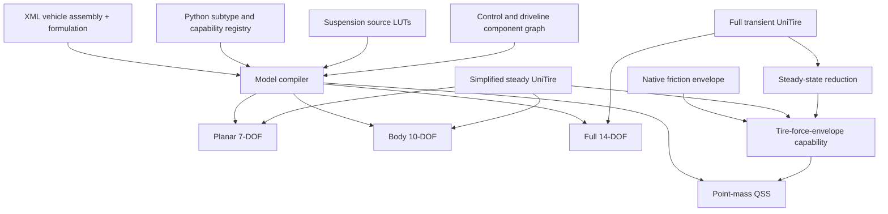
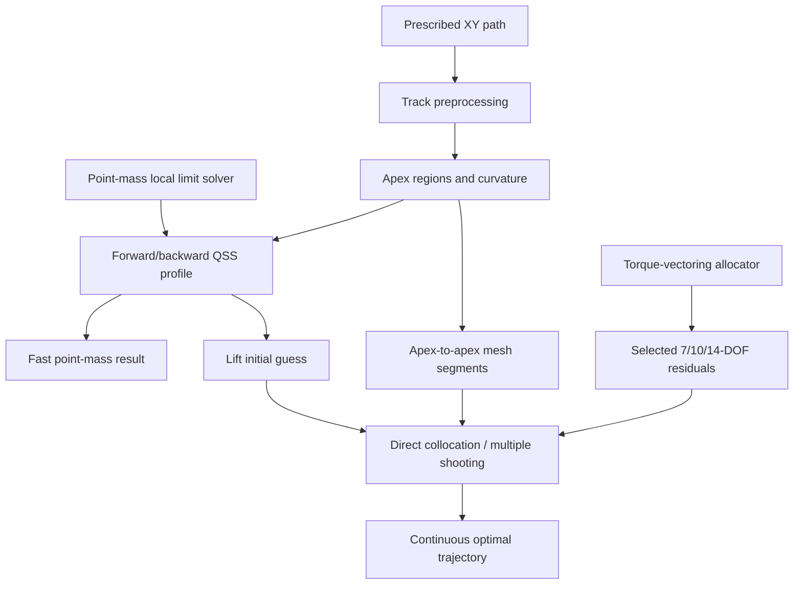
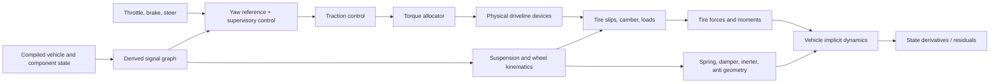

# Simplified Vehicle Models — Scope and Master Plan

**Status:** architecture proposal for audit. This document defines scope and solver direction; it is not an implementation plan.

## 1\. Project goal

Build a Python vehicle-dynamics library centered on four vehicle models of increasing physical fidelity:

1. a point-mass quasi-steady-state lap-time model;
2. a planar rigid vehicle with four wheel-speed degrees of freedom;
3. a six-degree-of-freedom body with four wheel speeds and massless suspension elements;
4. a 14-degree-of-freedom full vehicle with unsprung masses and transient UniTire behavior.

All models operate on one prescribed path derived from XY coordinates. Racing-line optimization and track-width optimization are outside the initial scope. The higher-order models use steering to follow the prescribed path, not to select a different path.

The project should share vehicle parameters, track geometry, suspension data, tire parameter conventions, powertrain/brake models, torque-vectoring logic, result formats, and optimal-control infrastructure where physically appropriate. It should not force materially different models behind misleadingly identical equations.

Executable equations, solvers, adapters, and component factories are implemented in Python. Physical models and analysis formulations are declared in XML using stable `type` and `subtype` identifiers. A model-compilation step resolves XML references, validates capabilities, derives reduced representations, assembles component states and signal dependencies, and produces an immutable runtime model for simulation or optimization.

## 2\. Fixed modeling conventions

These conventions should be finalized before equations are implemented:

- SI units everywhere.
- Body axes: `+x` forward, `+y` right, `+z` down. This is the SAE J670 frame.
- Positive yaw is clockwise viewed from above.
- Track curvature `kappa > 0` denotes a right turn.
- A positive lateral acceleration points to the right.
- A right turn moves vertical load to the left wheels.
- Tire forces are forces acting on the vehicle.
- Vertical tire load `Fz > 0` is the compressive load magnitude.
- Wheel order is always `(FL, FR, RL, RR)`.
- Parameter data is separate from mutable simulation state.
- Public functions do not mutate caller-owned NumPy arrays.
- Mechanical DOF count and first-order state-vector length are documented separately.
- The initial road is flat. Bank, grade, and general 3D roads are deferred.

The vehicle frame and the reference MATLAB tire functions use the same SAE axes with `+y` right and `+z` down. The tire boundary therefore needs no lateral sign conversion. Verify the longitudinal sense at the boundary, so signs never depend on implicit MATLAB assumptions.

`core/conventions.py` declares this frame in code. The signed conventions are load-bearing in two places: the lateral load transfer must move load to the left wheels in a right turn, and the yaw moment from longitudinal force must use the SAE sign. A legacy `distance-radius-profile` track stores a radius magnitude only. It carries no turn direction, so its per-wheel left/right split is not a turn direction and must not be read as one. A signed track must supply a signed curvature instead.

### 2.1 Declarative XML and model compilation

#### XML identifies and parameterizes; Python implements

Every physical component, vehicle assembly, and analysis formulation is an XML model with a versioned identity:

```xml
<model
    schema-version="1.0"
    id="default-simple-tire"
    type="tire-model"
    subtype="unitire-simple">
    <parameters>
        <parameter name="reference_vertical_load" value="900.0" unit="N"/>
    </parameters>
</model>
```

XML must not contain executable expressions or arbitrary Python import paths. Python maintains a registry from stable `(type, subtype)` identifiers to validated factories and capability descriptors. Paths in XML are resolved relative to the containing XML file. Loading detects missing references, cycles, duplicate IDs, unknown parameters, unit errors, and incompatible schema versions.

Small scalar data belongs in XML. Large inspectable LUTs may be referenced as CSV, while large multidimensional numerical maps may use NPZ. Every referenced dataset declares units, axis meanings, interpolation, valid range, and extrapolation policy.

#### Separate the physical car from the analysis formulation

One canonical `vehicle-assembly` XML describes the physical car and references its tires, suspension, aero, brakes, powertrain, driveline devices, and controllers. Separate `vehicle-formulation` XML files select `point-mass`, `planar-7dof`, `body-10dof`, or `full-14dof` and reference the same assembly. This avoids copying mass, geometry, tires, or driveline parameters into four vehicle files.

```xml
<model type="vehicle-formulation" subtype="point-mass"
       id="example-car-point-mass" schema-version="1.0">
    <source ref="../vehicles/example-car.xml"/>
</model>
```

The formulation states what physical capabilities it requires; it does not hard-code allowed component subtypes.

#### Capability-based compatibility

Components expose small capabilities rather than inheriting from one large universal model class. Initial tire capabilities are:

- `tire-force-envelope`;
- `steady-combined-slip`;
- `transient-combined-slip`;
- `camber-sensitive`;
- `tire-moments`.

Vehicle tire requirements are:

| Formulation | Required tire capabilities |
| --- | --- |
| Point mass | `tire-force-envelope` |
| Planar 7-DOF | `steady-combined-slip` |
| Body 10-DOF | `steady-combined-slip` |
| Full 14-DOF | `transient-combined-slip`, `camber-sensitive`, and required moments |

Registered one-way adapters may derive lower-fidelity capabilities from higher-fidelity sources:

```text
transient UniTire
    → steady-state reduction
steady combined-slip tire
    → compiled force envelope
```

The reverse reductions are invalid. A friction ellipse cannot provide slip-force dynamics, and a steady tire cannot invent transient deformation states.

Suspension capability groups should likewise remain separate:

- `suspension-kinematics`;
- `spring-force`;
- `damping-force`;
- `inertance-force`;
- `quasi-static-load-transfer`;
- `unsprung-dynamics`.

The same suspension source can compile into quasi-static relationships for Model 2, massless corner elements for Model 3, or full kinematics and force elements for Model 4.

#### Compilation pipeline

Model setup is an explicit compilation phase:

```text
XML source models
    → parse and schema validation
    → reference and component-graph resolution
    → capability analysis
    → adapter/reduction selection
    → LUT compilation and smoothing
    → signal dependency analysis
    → dynamic state-vector assembly
    → numeric/symbolic backend construction
    → immutable runtime model plus manifest
```

The manifest records source-file hashes, compiler version, selected adapters, grids, interpolation methods, approximation errors, state layout, signal connections, and backend capabilities. Compiled artifacts may be cached by the hash of all source files and compilation settings.

Automatic adapter choice is convenient for exploration, but formal studies should be able to specify the adapter and tolerance explicitly in XML. If more than one valid adapter path exists and no deterministic priority is declared, compilation fails as ambiguous.

#### Component ports and named signals

Components consume and provide explicitly named signals; they do not receive an unstructured copy of the full vehicle state. Each signal contract defines:

- physical meaning;
- units and shape;
- coordinate frame and sign convention;
- wheel ordering where applicable;
- whether it is a true, measured, estimated, commanded, or limited quantity;
- evaluation timing.

Examples include:

```text
vehicle.velocity.cg.body       [3], m/s
vehicle.speed.ground           scalar, m/s
vehicle.yaw-rate               scalar, rad/s
wheel.angular-speed            [4], rad/s, FL/FR/RL/RR
controller.requested-yaw-moment scalar, N*m
traction.maximum-wheel-torque  [4], N*m
```

Ground speed, slip ratio, sideslip, normal-load estimates, and available motor torque are derived signals, not states. Only quantities with memory governed by differential equations belong in the global state vector.

The authoritative port, parameter, internal-state, and backend contract belongs to the registered Python subtype descriptor. XML selects an implementation, provides parameters, and connects or overrides ports. The loader verifies that XML connections satisfy the Python descriptor so contracts cannot silently diverge.

#### Automatic state and evaluation-plan assembly

Components declare internal states only when they contain memory. Examples include a PID integral, a filtered traction-control estimate, actuator dynamics, clutch dynamics, or transient tire deformation. A passive differential declares no state.

The compiler concatenates the base vehicle states and component internal states in a deterministic order, assigns fixed slices, and records initialization, bounds, reset behavior, and hot-lap periodicity. No component hard-codes global state indices.

For algebraic evaluation, the compiler:

1. resolves each required signal to exactly one provider;
2. validates unit, shape, frame, and wheel-order compatibility;
3. inserts only approved signal adapters;
4. detects missing or ambiguous providers;
5. topologically sorts the signal graph;
6. prunes signals that do not contribute to requested outputs or residuals;
7. caches shared derived quantities;
8. generates direct array-index access and preallocated workspaces for NumPy;
9. constructs the equivalent symbolic graph once for optimal control.

This provides flexible named wiring during setup without string lookup, dictionaries, or full-state copying in the inner simulation loop.

True algebraic cycles are not resolved by arbitrary call order. They must either be rejected, broken with an explicit state/delay, or assembled into an implicit residual block.

#### Control and driveline responsibilities

A passive differential and a yaw-rate controller are not sibling implementations of one leaf `torque-split` category. The control chain is separated into:

```text
driver demand
    → yaw-reference and supervisory controllers
    → traction controller
    → torque allocator
    → physical torque-split/driveline device
    → wheel torques
```

Initial component types are:

- `yaw-reference`;
- `yaw-controller`;
- `traction-controller`;
- `torque-allocator`;
- `torque-split-device`;
- composite `drive-control-system`.

A clutch LSD may require only input torque, input speed, and left/right wheel speeds. A linear 2-DOF yaw-reference PID with integrated traction control may require ground speed, steering, yaw rate, wheel speeds, and additional estimates. Both can participate in a composite system that ultimately provides `driven-wheel-torques`, while retaining distinct roles and minimal input sets.

The yaw-reference model calculates target yaw rate. The yaw controller converts yaw error into requested yaw moment. Traction control provides wheel-torque limits or reductions. The allocator converts total torque and yaw-moment requests into shaft-torque requests. The physical differential or active driveline then determines actual wheel torques and reaction torques.

Each component also declares numerical capabilities such as `numeric-evaluation`, `symbolic-evaluation`, `analytic-jacobian`, `smooth-first-derivative`, `smooth-second-derivative`, `implicit-residual`, and `mass-matrix`. The optimal-control compiler rejects or explicitly smooths components that cannot meet the selected solver's derivative requirements.

### 2.2 Python naming and project terminology

The legacy MATLAB repositories establish the preferred vehicle-dynamics vocabulary, while Python identifiers follow PEP 8 rather than preserving MATLAB capitalization.

#### Identifier formatting

- Python modules, functions, methods, variables, parameters, and attributes use lowercase `snake_case`.
- Classes and protocols use `CapWords`; exceptions for established technical initialisms must be applied consistently.
- Constants use `UPPER_SNAKE_CASE`.
- Private implementation names begin with one underscore.
- XML `type`, `subtype`, capability, port, and model-ID values remain lowercase kebab-case because they are external stable identifiers, not Python variables. XML parameter names that map to Python attributes use lowercase `snake_case`.
- Python filenames use lowercase `snake_case.py`; XML filenames use lowercase kebab-case `.xml`.
- Boolean values use predicates such as `is_closed`, `has_contact`, `supports_camber`, and `requires_symbolic_backend`.
- Collection names are plural. A four-element vector is `wheel_speeds` or `wheel_torques`; a scalar for one corner is `wheel_speed` or `wheel_torque`.
- Do not encode units in an identifier when the parameter/result schema already declares units. Add a unit suffix only when two representations with different units coexist in one scope.

Examples translated from the MATLAB repositories:

| MATLAB-style name | Python name |
| --- | --- |
| `driverMass` | `driver_mass` |
| `totalMass` | `total_mass` |
| `pitchInertia` | `pitch_inertia` |
| `frontTireStiffness` | `front_tire_stiffness` |
| `effectiveRollRadius` | `effective_radius` |
| `inverterEfficiency` | `inverter_efficiency` |
| `totalPowerLimit` | `total_power_limit` |
| `brakeBias` | `brake_bias` |
| `omegaHub` | `hub_angular_speed` |
| `fitData` | `fit_data` |
| `fitReport` | `fit_report` |
| `damperTable` | `damper_table` |
| `springCurve` | `spring_curve` |
| `inertanceSweep` | `inertance_sweep` |
| `calculateMaxBraking` | `calculate_max_braking` |
| `estimateOmegaHub` | `estimate_hub_angular_speed` |
| `evaluateSimpleCombinedSlip` | `evaluate_simple_combined_slip` |

#### Domain symbols

Public APIs and data schemas prefer descriptive words. Short conventional symbols are acceptable in tightly scoped equation code when they match standard vehicle-dynamics notation. They remain lowercase and separate axes with underscores:

```text
f_x, f_y, f_z
m_x, m_y, m_z
v_x, v_y, v_z
a_x, a_y, a_z
i_xx, i_yy, i_zz
alpha, kappa, gamma, omega
```

Do not use mixed-case variables such as `Fz`, `Vx`, `Izz`, `FxData`, or `SAabs` in Python. Use `f_z`, `v_x`, `i_zz`, `f_x_data`, and `absolute_slip_angle` respectively. Established project initialisms are lowercase in variables: `cg`, `cop`, `lltd`, `ggv`, `lut`, `pid`, `rms`, `rpm`, and `sae`.

Public APIs expand ambiguous symbols: `vertical_load`, `longitudinal_force`, `reference_vertical_load`, `normalized_vertical_load`, `rolling_speed`, `longitudinal_slip_speed`, and `lateral_slip_speed`. UniTire coefficient identifiers use lowercase snake-separated notation such as `k_x`, `k_y`, `k_cx`, `k_cy`, `e_1`, and `d_x_0`; legacy `.mat` import adapters perform the mapping from MATLAB field names. Use `lateral_load_transfer_distribution` in public schemas and reserve `lltd` for compact local equations.

#### Preferred technical words

Use the vocabulary already recurring in the MATLAB work, normalized as follows:

- `vehicle` for reusable model, state, parameter, and API names; reserve `car` for prose or a specific user-level example;
- `drivetrain` for torque transmission and physical torque-split devices;
- `powertrain` for torque production, energy source, motors, and inverters;
- `aero`, `downforce`, `drag_force`, and `center_of_pressure`;
- `wheelbase`, `track_width`, `cg_location`, `cg_height`, `driver_mass`, `sprung_mass`, and `unsprung_mass`;
- `wheel_rate`, `motion_ratio`, `jounce`, `spring_curve`, `damper_curve`, `damper_click`, `compression`, `rebound`, and `inertance`;
- `heave`, `body_pitch`, `hub_displacement`, `contact_patch_load`, `contact_patch_load_variation`, and `heave_damping_ratio` for vertical-dynamics outputs;
- `upper_ball_joint`, `lower_ball_joint`, `upright`, `fore`, `aft`, `inboard`, and `outboard` for suspension kinematics;
- `wheel_speed` in controls and results, and `wheel_angular_speed` where rotational units must be explicit;
- `slip_angle`, `slip_ratio`, `inclination_angle` or `camber`, `toe`, `yaw_rate`, `roll_rate`, and `pitch_rate`;
- `cornering_stiffness`, `longitudinal_slip_stiffness`, `carcass_stiffness`, `pneumatic_trail`, `aligning_moment`, `overturning_moment`, and `rolling_resistance_moment`;
- `throttle`, `accelerator_pedal_position`, `brake`, `steering`, `brake_bias`, `wheel_torque`, and `requested_yaw_moment`;
- `front` and `rear` as the leading qualifier in public names rather than single-letter `f` and `r`; use `fl`, `fr`, `rl`, and `rr` only as standard wheel-position labels;
- `load_transfer`, not the legacy phrase `weight_transfer`, because the transferred quantity is normal load rather than vehicle weight;
- `loaded_radius` and `effective_radius` as distinct tire quantities, and `rolling_resistance` for the resistive force or moment.

`UniTire` is the spelling in prose and class documentation. Python identifiers use `unitire`, for example `unitire_simple.py`, `evaluate_unitire()`, and `unitire_parameters`.

#### Comment language: ASD-STE100

All source-code comments must comply with ASD-STE100 Simplified Technical English (STE), as specified by the [ASD Simplified Technical English Maintenance Group](https://www.asd-ste100.org). This requirement applies to inline comments, block comments, module comments, and explanatory text inside XML comments. Public docstrings should follow the same language rules unless a Python API tool requires a fixed syntax.

Apply these project rules:

- Use an approved STE word with its approved meaning when one is available.
- Add necessary vehicle-dynamics terms to a controlled project dictionary. Define each project term once and use it consistently.
- Use one technical term for one concept. Do not alternate between synonyms such as `damper` and `shock`.
- Use short, complete sentences. Keep procedural sentences at 20 words or fewer and descriptive sentences at 25 words or fewer.
- Use the active voice when the actor is known.
- Use the imperative form for an instruction.
- Use the simple present tense for descriptions when possible.
- Put only one instruction in each sentence.
- Avoid contractions, idioms, slang, humor, rhetorical questions, and conversational filler.
- Avoid vague pronouns and unclear references. Repeat the applicable noun when necessary.
- Avoid long noun clusters. Separate or rewrite them when they can have more than one meaning.
- Use `for example` instead of `e.g.` and use `that is` instead of `i.e.`.
- Use approved abbreviations only. Define each project abbreviation in the glossary before use.
- Write a comment only when it adds purpose, assumptions, units, constraints, sign conventions, numerical safeguards, or non-obvious reasoning. Do not restate the code.

Examples:

```python
# Incorrect: Handle weird low-speed stuff so it does not blow up.
# Correct: Prevent division by zero when the vehicle speed is low.

# Incorrect: Figure out Fz and then do the tire calculations.
# Correct: Calculate the vertical load for each tire.
# Correct: Use each vertical load to calculate the tire forces.
```

The applicable ASD-STE100 issue and the controlled project dictionary must be recorded in the repository. Automated language checks can identify sentence length, prohibited phrases, undefined abbreviations, and common violations, but technical review remains mandatory.

#### Function verb conventions

Legacy functions repeatedly use calculate, evaluate, estimate, generate, build, create, apply, set, read, resolve, predict, fit, and solve. Standardize their meanings:

- `calculate_`: direct physical derived quantity with no iteration;
- `evaluate_`: evaluate a component model at supplied inputs;
- `solve_`: perform iteration, root finding, integration, equilibrium, or optimization;
- `estimate_`: intentionally approximate or infer an unavailable quantity;
- `compile_`: transform XML/capabilities into a reusable runtime representation;
- `build_`: construct an in-memory object from validated inputs;
- `load_`: read a file or persisted artifact;
- `parse_`: convert raw XML/text into syntax-level structures;
- `validate_`: check a contract without changing the object;
- `fit_`: identify parameters from data;
- `generate_`: create synthetic data, a mesh, report, or exported artifact;
- `apply_`: apply a control, transformation, or parameter update and return the result;
- avoid `set_` for public numerical functions unless they intentionally mutate an object.

Use `result` for a structured public output, `state` for dynamic state, `parameters` for immutable model data, `inputs` or `controls` for external actuation, and `outputs` for named component outputs. Avoid generic public names such as `out`, `data`, `value`, `x`, or `temp`; they remain acceptable only in very small local mathematical scopes.

Avoid legacy public abbreviations such as `apps`, `sa`, `ia`, `mr`, `tq`, `dir`, `mag`, `lat`, `lon`, `comb`, and `fwd`; use their expanded terms. Preserve `cpl`, `frf`, and `kpi` only where a documented project glossary makes them unambiguous, otherwise use `contact_patch_load`, `frequency_response`, and `performance_metric`. Metric names must describe the calculation: a maximum is `peak`, not `rms`, and a normalized contact-patch-load ratio must not be named as a dimensional load.

## 3\. The four vehicle models

### 3.1 Model 1 — Point-mass QSS car

**Purpose:** fast minimum-time lap calculation and initial-guess generation for all higher-order models.

**Dynamic fidelity:** algebraic/quasi steady-state; no wheel-speed or attitude states.

**Required tire capability:** a load- and speed-aware force envelope at four contact patches. A native load-sensitive friction ellipse provides this capability directly; a simplified or full UniTire source may be compiled into an envelope during solver setup.

**Included behavior:**

- prescribed XY path and calculated distance/curvature;
- four-wheel static, aerodynamic, longitudinal, and lateral load distribution;
- load-sensitive longitudinal and lateral friction capacity;
- combined-force envelope, represented analytically or by a compiled smooth LUT;
- motor torque, power, gearing, efficiency, and driven-wheel limits;
- friction braking, fixed or controlled brake allocation;
- aerodynamic drag and downforce;
- torque-vectoring-aware force allocation where applicable;
- hot-lap periodic boundary condition;
- standing-start boundary condition;
- speed, acceleration, throttle, brake, loads, tire utilization, active constraints, and lap time.

The primary fast solver is the live-limit forward/backward method described in Section 7. A direct optimal-control formulation may also be provided through the shared solver framework.

### 3.2 Model 2 — Planar rigid vehicle with wheel speeds

**Mechanical DOF:** seven.

- body longitudinal motion;
- body lateral motion;
- body yaw;
- four wheel rotations.

Global `X`, `Y`, and heading are integrated pose coordinates needed to locate the vehicle, but do not change the conventional seven-DOF model name.

**Tire model:** simplified steady-state UniTire, combined slip, zero camber, and no tire-relaxation states.

**Tire outputs used by the vehicle:**

- longitudinal force `Fx`;
- lateral force `Fy`;
- aligning moment `Mz`;
- rolling-resistance moment.

**Vehicle inputs:**

- throttle;
- brake;
- steering command.

A compiled drive-control component graph converts driver commands into four wheel torques. It may contain a yaw-reference model, yaw controller, traction controller, torque allocator, and physical torque-split devices; passive drivetrains instantiate only the components they require.

**Normal loads:** solved quasi-statically at each evaluation. The calculation includes:

- static load distribution;
- aerodynamic load distribution;
- longitudinal and lateral load transfer;
- jounce-dependent wheel-rate relationships;
- jounce-dependent roll-center and pitch/anti geometry;
- configurable lateral load-transfer distribution.

A strict seven-DOF model has no heave, roll, pitch, jounce-rate, or jounce-acceleration states. Consequently, true damper and inerter forces cannot be included dynamically without hidden states. Suspension damping and inertance parameters may be shared with the higher models, but their dynamic contributions are zero in the strict quasi-static seven-DOF model. If transient inertance must affect this model, auxiliary load-transfer states are required and it should no longer be described as strictly seven DOF.

### 3.3 Model 3 — Six-DOF body with four wheel speeds

**Mechanical DOF:** ten.

- body translation: longitudinal, lateral, and vertical;
- body rotation: roll, pitch, and yaw;
- four wheel rotations.

**Tire model:** the same simplified steady-state, zero-camber UniTire used by Model 2.

**Suspension/contact model:** four massless corner elements support the body on a flat road. Corner forces use jounce-dependent lookup data for:

- spring force or wheel rate;
- damping;
- inertance;
- force application points;
- roll-center and pitch-center behavior;
- anti-dive, anti-lift, and anti-squat geometry.

Because suspension inertance depends on corner acceleration, this model naturally has an implicit mass-matrix form:

```text
M_effective(q) * q_ddot = f(q, q_dot, wheel_speed, controls)
```

The dynamics interface must support an implicit residual or mass matrix rather than requiring every equation to be manually reduced to an explicit derivative.

This model is the massless-unsprung approximation of Model 4, but its zero-camber simplified tire law makes it more than a parameter switch. The two models should share body, force-transformation, control, and suspension infrastructure while retaining distinct tire/contact assemblies.

### 3.4 Model 4 — Full 14-DOF vehicle

**Mechanical DOF:** fourteen.

- six sprung-body DOF;
- four unsprung vertical DOF;
- four wheel rotations.

```text
6 body + 4 unsprung vertical + 4 wheel rotation = 14 mechanical DOF
```

Wheel-center longitudinal and lateral positions are determined kinematically from body pose, steering, and suspension geometry. Only the four vertical unsprung motions are independent wheel-center translational DOF.

**Tire model:** full transient UniTire with:

- combined longitudinal and lateral slip;
- camber effects;
- load sensitivity;
- speed sensitivity;
- longitudinal and lateral transient deformation/relaxation;
- pneumatic-trail and residual-aligning-moment behavior;
- aligning moment;
- overturning moment;
- rolling-resistance moment.

The MATLAB `unitire_solve.m` implementation is a fuller steady-state formulation with camber. It can define the steady-state force/moment target, but transient state equations must be added around it. At minimum, longitudinal and lateral relaxation at four tires adds eight internal first-order states.

These tire states do not rename the model as 22 DOF. The vehicle remains a 14-mechanical-DOF model with additional transient tire states. A representative first-order state count is approximately:

- body pose and velocity: 12;
- unsprung position and velocity: 8;
- wheel angular speed: 4;
- minimum tire relaxation states: 8;
- total before optional actuator states: approximately 32.

**Suspension and kinematic LUTs:** each corner evaluates jounce-dependent data for:

- wheel-center position;
- camber;
- toe;
- steer contribution;
- motion ratio;
- spring force or wheel rate;
- damper force/coefficient;
- inertance;
- roll-center and pitch-center geometry;
- anti-dive, anti-lift, and anti-squat behavior;
- relevant force application points.

Vertical tire stiffness and damping generate road-contact normal force. Suspension and tire forces couple the body and four unsprung masses. Inertance contributes to the coupled effective mass matrix.

## 4\. Tire-model boundaries

### 4.1 Tire force envelope and friction ellipse

The point-mass model consumes a generic `tire-force-envelope` capability rather than requiring a particular tire subtype. A native load-sensitive friction ellipse provides it analytically. For each tire:

```text
Fx_capacity = mu_x(Fz) * Fz
Fy_capacity = mu_y(Fz) * Fz

(|Fx| / Fx_capacity)^n + (|Fy| / Fy_capacity)^n <= 1
```

The load-sensitivity law must be bounded, defined at zero load, and expressed relative to a reference load. A native implementation may use a clipped power or linear law with `n = 2`.

A steady-state UniTire source can be compiled into the same capability by sweeping or optimizing slip angle and slip ratio over load, speed, and force direction. The preferred compiled representation is a smooth polar boundary `F_limit(Fz, speed, direction)`. A fitted ellipse or quadrant-specific superellipse is acceptable only when its error against the source tire remains below a declared tolerance. Because the simplified UniTire friction law depends on slip velocity, collapsing the speed dimension requires an explicit reference speed and reported approximation error.

### 4.2 Simplified steady-state UniTire

Used by Models 2 and 3. The Python implementation should be a validated port of:

```text
~/Dev/FSAE-VD-Personal-Scripts/
  Yaw Dynamics/Tire Model/unitire_simple_solve.m
```

Its main inputs are slip angle, slip ratio, normal load, wheel speed, tire parameters, and road-friction parameters. It computes steady-state combined-slip forces and selected moments with zero inclination angle.

No relaxation-length state is integrated even if the model reports a relaxation-length diagnostic.

### 4.3 Full transient UniTire

Used only by Model 4. Its steady-state target should be based on the behavior and fitted parameters associated with:

```text
~/Dev/FSAE-VD-Personal-Scripts/
  Yaw Dynamics/Tire Model/unitire_solve.m
```

The transient formulation must explicitly define:

- selected internal deformation/slip states;
- relaxation equations;
- low-speed regularization;
- behavior during contact loss and re-contact;
- dependence of relaxation properties on load and operating point;
- initialization at steady rolling and at a standing start.

The full model must receive camber and wheel orientation from the suspension-kinematics layer rather than treating camber as a free control.

## 5\. Suspension LUT requirements

The suspension input should be a coherent per-corner dataset indexed primarily by jounce, not a collection of unrelated interpolation calls. The schema should distinguish:

- geometric outputs: wheel position, camber, toe, motion ratio, centers, anti percentages;
- constitutive outputs: spring force/rate, damping, inertance;
- metadata: sign convention, zero-jounce definition, units, valid range, and extrapolation policy.

Optimal-control solvers require useful derivatives. Raw piecewise-linear tables have discontinuous derivatives, so optimization-facing LUTs should use validated differentiable interpolation, such as shape-preserving or constrained smooth splines. Extrapolation beyond physical jounce limits should normally be prohibited by constraints rather than silently continued.

## 6\. Track model

All models use the same prescribed path:

1. validate finite XY samples and remove consecutive duplicates;
2. determine whether the path is open or closed;
3. resample by cumulative arc length;
4. calculate heading and signed curvature;
5. optionally smooth geometry before differentiation;
6. detect geometric apex candidates for diagnostics, initialization, and solver segmentation.

The higher-order models may use path-relative coordinates such as progress `s`, lateral error `n`, and heading error. Lateral error is constrained tightly enough to represent following the supplied path; it is not a racing-line decision variable.

## 7\. Specialized point-mass forward/backward solver

### 7.1 Why it remains valuable

The point-mass state along the path is essentially scalar speed. A forward maximum-acceleration trace and backward maximum-braking trace can therefore be joined where their speed envelopes intersect.

Unlike the legacy apex-splicing implementation, local limits are recomputed from the instantaneous trial condition rather than read from one precomputed GGV surface.

### 7.2 Apex interpretation

A geometric apex is a local curvature maximum and is a useful candidate for a local speed minimum, but the following quantities do not universally occur at the same path position:

- maximum curvature;
- maximum lateral acceleration;
- minimum speed;
- zero pedal input.

At a speed minimum, net longitudinal acceleration is zero. Throttle may still be needed to balance drag and rolling resistance. Therefore, zero pedal and maximum lateral acceleration are outputs to verify, not mandatory apex constraints.

For an isolated corner, local optimization may find an apex operating point containing:

- maximum feasible speed;
- tire-force allocation;
- normal loads;
- throttle/brake balance;
- active constraints.

For higher-order initial guesses, the local equilibrium solve may additionally estimate sideslip `beta`, steering `delta`, yaw rate, wheel speeds, and torque-vectoring allocation.

### 7.3 Live local limit solve

At each `(s, speed, curvature)` trial condition:

1. compute lateral acceleration demand `ay = speed**2 * curvature`;
2. solve the four normal loads, including load-transfer dependence on acceleration;
3. allocate lateral forces and required yaw behavior;
4. calculate remaining combined-force capacity;
5. apply powertrain, brake, drag, and rolling-resistance limits;
6. run the torque-vectoring allocator if enabled;
7. return feasible `ax_min`, `ax_max`, wheel forces, loads, utilization, and active constraints.

### 7.4 Profile construction

- Calculate a live lateral-feasibility speed ceiling at each path node.
- Sweep forward using the maximum feasible acceleration transition.
- Sweep backward using the maximum feasible braking transition.
- Alternate until the envelope converges.
- For a hot lap, wrap the indices and enforce periodic start/finish speed.
- For a standing start, enforce zero initial speed and do not wrap finish to start.
- Recover throttle and brake by replaying the converged speed profile through the local vehicle solver.

The spatial transition uses:

```text
v_next**2 = v_now**2 + 2 * ax * ds
```

with acceleration evaluated through an implicit trial-speed solve rather than frozen at only one endpoint.

## 8\. Why simple apex splicing does not solve the higher models

For the point mass, joining speed is effectively joining the state. For Model 2, a join must match at least:

```text
speed, sideslip, yaw rate, and four wheel speeds
```

Models 3 and 4 additionally require continuity of body attitude/rates, suspension states, unsprung states, and transient tire states. Independently integrated trajectories may cross in speed while disagreeing everywhere else.

Maintaining a desired yaw moment and staying under a lateral-acceleration limit is also insufficient. During curvature transitions:

```text
Izz * yaw_acceleration = total_yaw_moment
```

The required yaw moment depends on the desired future yaw-rate trajectory, while locally maximizing longitudinal acceleration can create sideslip, roll, pitch, wheel-slip, or tire-relaxation states that make the future path infeasible.

Literal backward integration is especially unsuitable for Models 3 and 4. Physical damping and stable tire relaxation become anti-damping and unstable relaxation when time is reversed.

Therefore:

| Model | Role of direct forward/backward apex method |
| --- | --- |
| Point mass | Primary exact method within QSS assumptions |
| Planar model treated quasi-steadily | Possible approximate fast method |
| Transient 7-DOF | Initial guess only |
| 10-DOF | Initial guess and segment definition only |
| 14-DOF with transient tires | Initial guess and segment definition; no literal backward simulation |

## 9\. Shared optimal-control framework

### 9.1 Common problem interface

All four models can participate in a common direct-transcription framework by exposing an implicit residual:

```text
R(independent_variable, state, state_derivative,
  algebraic_variables, controls, track, parameters) = 0
```

The framework owns:

- mesh and collocation/multiple-shooting structure;
- variable bounds and scaling;
- path constraints;
- boundary and periodicity constraints;
- objective construction;
- nonlinear-program assembly;
- convergence diagnostics and result reconstruction.

Each model owns:

- state and algebraic-variable definitions;
- dynamic/force residuals;
- contact and tire equations;
- model-specific constraints;
- output calculations.

### 9.2 Controls

The point-mass model uses:

```text
throttle, brake
```

Models 2–4 use:

```text
throttle, brake, steering
```

Scalar throttle and brake commands require a defined lower-level allocation policy. For an AWD vehicle, throttle does not directly specify four independent motor torques. The torque-vectoring block receives total longitudinal demand and desired yaw behavior, then selects feasible wheel torques.

Steering should represent a defined actuator quantity such as rack displacement or normalized steering command. Rate limits should be represented either as direct control-rate constraints or actuator states.

Separate nonnegative throttle and brake variables can create unwanted overlap. The initial optimizer should use either a strong overlap penalty or a smooth signed longitudinal command internally while reporting separate throttle/brake outputs. Strict complementarity can be added only if necessary.

### 9.3 Objective and constraints

The primary objective is minimum elapsed time subject to:

- vehicle dynamics;
- tire and contact equations;
- prescribed-path tracking;
- actuator magnitude and rate limits;
- motor power/torque limits;
- brake limits;
- wheel-speed limits;
- suspension travel and contact constraints;
- initial/final or periodic boundary conditions.

The solution is a nonconvex local optimum. Results must be qualified by initial guess, mesh resolution, scaling, constraint residuals, and solver tolerances.

### 9.4 Spatial and time formulations

A spatial formulation is preferred for hot laps because lap length is fixed and the path is indexed naturally by distance. It requires positive path progress and becomes singular at zero speed.

A time formulation is preferred for standing starts and general transient maneuvers. A standing-start lap may use either:

- a fully time-domain problem; or
- a short time-domain launch phase joined to a spatial lap phase.

The model residuals should be reusable under either transcription.

### 9.5 Apex-segmented optimal control

Apexes remain valuable without being treated as guaranteed trajectory joins:

1. detect geometric apex regions;
2. solve local steady-state apex seeds for speed and available equilibrium variables;
3. generate the point-mass forward/backward profile;
4. lift that profile into guesses for sideslip, steering, yaw rate, wheel speeds, body attitude, suspension states, and tire states;
5. divide the lap into apex-to-apex optimization segments;
6. solve with multiple shooting or direct collocation;
7. enforce complete state continuity at every segment boundary;
8. enforce complete periodicity for a hot lap.

At a segment join:

```text
state_end(segment_k) - state_start(segment_k+1) = 0
```

The optimizer, rather than an assumed speed-curve intersection, makes the higher-order trajectories join physically.

### 9.6 Continuation across models

The lower models provide structured initial guesses:

```text
Point-mass optimum
    ↓
7-DOF optimum
    ↓
10-DOF optimum
    ↓
14-DOF optimum
```

The 14-DOF solve may require additional continuation:

1. initialize with steady-state tires;
2. enable body and suspension dynamics;
3. enable unsprung masses;
4. enable camber/toe kinematics;
5. enable transient tire states;
6. refine the mesh.

### 9.7 Forward virtual-driver simulation (experimental alternative)

Full-lap optimization is not required for every correlation or parameter-study run.
A second workflow may use a prescribed-path speed planner, a preview driver, and
forward integration of the selected vehicle. The driver consumes physical signals
and supplies throttle, brake and steering commands; it does not own model-specific
wheel, suspension, body-attitude or tire-relaxation states.

The shared plant boundary must accept nonsingular mass-matrix systems and provide
an extension point for implicit residual/contact backends. Model 3 retains
suspension inertance in its effective mass matrix. Model 4 retains unsprung motion,
camber and transient tire states. Singular DAEs require a suitable backend and
consistent initialization; they must not be silently replaced with explicit or
pseudoinverse dynamics. The same driver signals can serve all three models, but
controller settings, initialization and validation remain model-specific.

The speed planner may propagate scalar bounds backward. All vehicle and component
states advance forward in time; Section 8's prohibition on literal backward
integration remains in force. The supplied path is unchanged: racing-line
optimization remains out of scope.

A forward result is a driven trajectory, not a minimum-time stationary solution.
Report physical/integration validity, path constraints, full-state periodicity,
accuracy refinement and total runtime separately. A completed initial-value lap
alone does not satisfy a periodic hot-lap acceptance gate. The existing optimal
control framework remains available for offline optimality studies.

An initial transient planar prototype and the compatibility analysis are documented
in [the forward-driver design](<validation/iem24-murphy/forward-driver-design.md>).
It preserves four wheel-speed states and the requested wheel inertia. Its first
planner is a conservative kinematic request, not the production live-limit planner.
Body 10DoF and full 14DoF plant implementations are still future milestones;
synthetic mass-matrix interface tests do not establish their physical validation.

## 10\. Control, allocation, and torque-distribution role

Torque vectoring is a composed control and allocation path used inside local QSS solves and dynamic optimal-control evaluations:

```text
Throttle/brake and steering
        ↓
Yaw reference and supervisory control
        ↓
Requested total torque + requested yaw moment
        ↓
Traction-control wheel-torque limits
        ↓
Torque allocator
        ↓
Physical driveline / torque-split devices
        ↓
FL, FR, RL, RR drive/brake torques
```

The allocator respects:

- motor torque-speed limits;
- total power limit;
- brake capability and allocation rules;
- wheel-speed limits;
- traction-controller limits;
- tire combined-slip capability;
- authority and constraints of the physical driveline.

It must return residual tracking error and infeasibility status if total-force and yaw-moment requests cannot both be achieved. The physical device must separately report the difference between requested and realizable shaft torques. For optimal-control performance, allocation should preferably be analytical or a small smooth convex problem. A nested general nonlinear optimization at every mesh point would be expensive and may produce inconsistent derivatives.

Controller states such as PID integrals, filters, estimators, and actuator states are compiled into the global state vector. Hot-lap problems declare which of these states are periodic; standing-start problems declare reset values. Hard switching, hysteresis, and saturation logic must either provide a solver-compatible smooth form or be excluded from gradient-based optimal control while remaining available for forward simulation.

## 11\. Solver technology

NumPy remains the required numerical data and reference-calculation foundation. A full sparse optimal-control solve for Models 3 and 4 is not realistically a NumPy-only nonlinear optimization problem.

Recommended split:

- NumPy for parameters, standalone simulation, validation, results, and post-processing;
- a sparse automatic-differentiation/transcription backend for optimal control;
- IPOPT or an equivalent sparse constrained NLP solver;
- CasADi is the leading candidate for transcription and derivatives.

A key design decision is that arbitrary NumPy implementations cannot be differentiated directly by CasADi. The project must choose one of:

1. write optimization-facing equations in CasADi and provide numerical wrappers;
2. implement a small common math abstraction supporting NumPy and symbolic values;
3. use a differentiable array system and compatible sparse NLP interface.

Duplicating independent NumPy and symbolic physics implementations should be avoided unless cross-comparison is treated as a deliberate verification strategy.

## 12\. Architecture block diagrams

### 12.1 Model hierarchy



### 12.2 Solver flow



### 12.3 High-fidelity force path



## 13\. Proposed package structure

```text
schemas/
├── model.xsd
├── vehicle-assembly.xsd
├── vehicle-formulation.xsd
├── component.xsd
└── suspension-lut.xsd

models/
├── vehicles/                 # Canonical physical vehicle assemblies
├── formulations/             # Point-mass, 7-, 10-, and 14-DOF XML
├── tires/
├── suspensions/
├── powertrains/
├── brakes/
├── aero/
├── controllers/
├── allocators/
├── torque-split-devices/
└── data/                     # Referenced CSV/NPZ maps and LUTs

src/simplified_vehicle_models/
├── core/
│   ├── conventions.py
│   ├── numerics.py
│   └── types.py
├── xml/
│   ├── loader.py             # Parse, schema-check, and resolve references
│   ├── paths.py
│   └── manifest.py
├── compiler/
│   ├── registry.py           # (type, subtype) implementations/descriptors
│   ├── capabilities.py
│   ├── adapters.py
│   ├── component_graph.py
│   ├── signal_graph.py
│   ├── state_layout.py
│   └── compile.py
├── signals/
│   ├── definitions.py
│   ├── frames.py
│   └── adapters.py
├── parameters/
│   ├── vehicle.py
│   ├── tire.py
│   ├── suspension.py
│   ├── powertrain.py
│   ├── brakes.py
│   └── aero.py
├── tracks/
│   ├── types.py
│   ├── geometry.py
│   └── path_coordinates.py
├── tires/
│   ├── envelope.py
│   ├── friction_ellipse.py
│   ├── unitire_simple.py
│   ├── unitire_transient.py
│   └── compile_envelope.py
├── suspension/
│   ├── lookup.py
│   ├── kinematics.py
│   └── forces.py
├── controls/
│   ├── yaw_reference.py
│   ├── yaw_controller.py
│   ├── traction_control.py
│   ├── torque_allocator.py
│   ├── torque_split_device.py
│   ├── powertrain.py
│   └── brakes.py
├── formulations/
│   ├── point_mass.py
│   ├── planar_7dof.py
│   ├── body_10dof.py
│   └── full_14dof.py
├── solvers/
│   ├── local_limits.py
│   ├── forward_backward.py
│   ├── apex_equilibrium.py
│   ├── transcription.py
│   ├── multiple_shooting.py
│   ├── collocation.py
│   └── continuation.py
└── results/
    ├── traces.py
    └── diagnostics.py

tests/
├── xml/
├── compiler/
├── signals/
├── tracks/
├── tires/
├── suspension/
├── controls/
├── formulations/
├── forward_backward/
├── optimal_control/
└── regression/
```

Each implementation plan should create only the files required by its model or solver milestone; the full tree should not be scaffolded at once.

## 14\. Validation strategy

### 14.0 XML and model compiler

- schema-version, required-attribute, unit, and parameter validation;
- automated Python style checks enforcing lowercase `snake_case` functions, variables, parameters, attributes, and module names;
- automated ASD-STE100 comment checks plus mandatory technical-language review;
- controlled-vocabulary validation for project terms and abbreviations;
- relative-reference resolution and cycle detection;
- missing, ambiguous, dimensionally incompatible, and frame-incompatible signal connections;
- deterministic state layout independent of filesystem traversal order;
- state initialization, reset, and periodicity metadata;
- pruning of unused signals without changing outputs;
- detection or explicit implicit assembly of algebraic loops;
- reproducible compiled manifests and cache invalidation when any source changes;
- numerical and symbolic backend results compared at identical states;
- compiled UniTire envelope checked against source forces over load, speed, and force direction;
- rejection of an ellipse fit when declared error tolerance is exceeded.

### 14.1 Track and point-mass solver

- straight, circle, hairpin, and closed-oval synthetic paths;
- constant-radius speed compared with hand calculation;
- straight standing start with monotonic acceleration;
- start-index invariance for a closed hot lap;
- path-spacing convergence;
- live local limits checked against force and moment equilibrium;
- increasing available friction must not increase minimum lap time.

### 14.2 Simplified UniTire and 7-DOF model

- Python output compared directly with MATLAB `unitire_simple_solve.m` over load, slip-angle, slip-ratio, and wheel-speed sweeps;
- pure-slip and combined-slip symmetry/sign checks;
- straight free rolling;
- constant-radius steady-state equilibrium;
- step steer and drive/brake transients;
- torque-vectoring force/yaw-moment allocation residuals.

### 14.3 10-DOF model

- static ride-height equilibrium;
- symmetric heave response;
- pure roll and pure pitch sanity cases;
- effective mass change from inertance;
- suspension-work and force-sign checks;
- reduction toward planar behavior when vertical motions are constrained.

### 14.4 Full UniTire and 14-DOF model

- steady-state limit compared with MATLAB `unitire_solve.m`;
- transient relaxation converges to the steady-state target;
- camber sweeps and combined-slip/camber sweeps;
- contact loss and re-contact behavior;
- suspension jounce-to-camber/toe verification;
- static equilibrium and wheel-hop/ride-mode trends;
- time-step and collocation-mesh convergence.

### 14.5 Optimal-control results

- all dynamic and algebraic residuals below declared tolerances;
- actuator, track, contact, tire, and suspension constraints satisfied between mesh nodes as well as at nodes;
- complete state continuity at segment joins;
- hot-lap periodicity for all periodic states;
- comparison against the point-mass lower bound/baseline;
- multiple initial guesses and mesh refinements used to assess local-optimum sensitivity.

## 15\. Delivery sequence

The project should be delivered as a model-compilation foundation, four model milestones, and shared solver work—not as a large ladder of intermediate vehicle models.

### Foundation — XML, capabilities, signals, and compilation

- versioned XML schemas and relative-reference loading;
- PEP 8 identifier formatting and the project vehicle-dynamics terminology glossary;
- the selected ASD-STE100 issue, controlled project dictionary, and comment-review process;
- Python subtype/capability registry;
- physical vehicle assembly separated from analysis formulation;
- component graph, signal graph, and deterministic state-layout compiler;
- unit, frame, shape, wheel-order, and backend validation;
- reduction/adapter registry and compiled manifest;
- NumPy evaluation-plan generation and symbolic-backend contract;
- controller, allocator, and physical driveline component boundaries.

### Milestone 1 — Point-mass QSS and fast lap solver

- conventions and parameters;
- path processing;
- generic tire-force-envelope interface;
- native load-sensitive friction ellipse;
- UniTire-to-envelope compiler with approximation diagnostics;
- live local acceleration solver;
- forward/backward hot-lap and standing-start profiles;
- composed control/allocator/driveline interface;
- validation tracks and diagnostics.

### Milestone 2 — Planar 7-DOF

- validated simplified UniTire port;
- four wheel-speed and planar body dynamics;
- quasi-static normal-load solution with suspension geometry LUTs;
- path-following controls;
- yaw-reference, yaw-controller, traction-control, allocator, and physical differential composition;
- automatic controller-state and signal-plan assembly;
- steady-state apex operating-point solve.

### Milestone 3 — Body 10-DOF

- six-DOF body equations;
- massless suspension force elements;
- spring, damper, inertance, and anti-geometry LUT evaluation;
- implicit mass-matrix dynamics;
- reuse of simplified UniTire and controls.

### Milestone 4 — Full 14-DOF

- four unsprung vertical dynamics;
- vertical tire contact;
- full suspension kinematics including camber and toe;
- full UniTire steady-state target;
- transient tire states and initialization;
- coupled body/suspension/contact dynamics.

### Shared optimal-control milestone

Begin the common transcription interface with the point mass, then validate it on each model as that model becomes available. Complete features include:

- time and spatial transcriptions;
- apex-segmented multiple shooting/direct collocation;
- complete join and periodicity constraints;
- continuation from lower- to higher-fidelity models;
- sparse NLP integration and diagnostics.

The specialized point-mass forward/backward solver remains a permanent supported solver rather than being discarded after optimal control is available.

## 16\. Deferred scope

- racing-line optimization;
- track-width selection;
- general 3D road surfaces, bank, and grade;
- tire temperature, pressure evolution, and wear;
- battery thermal and electrochemical dynamics;
- deformable chassis;
- additional suspension-link flexibility;
- real-time/HIL deployment;
- GUI development.

## 17\. Remaining audit decisions

 1. Confirm the vehicle-to-tire axis and sign-conversion standard.
 2. Define whether the prescribed path is enforced exactly or with a small allowed lateral/heading tolerance.
 3. Define throttle-to-wheel-torque and brake-to-wheel-torque allocation for each drivetrain.
 4. Define the torque-vectoring request interface and priority when total force and yaw moment cannot both be achieved.
 5. Confirm that true damping/inertance effects are intentionally inactive in the strict quasi-static 7-DOF load-transfer solve.
 6. Select the exact transient UniTire states and relaxation equations.
 7. Define contact-loss handling for transient tire states.
 8. Define the suspension LUT schema, interpolation method, and valid jounce range.
 9. Select the optimization backend, with CasADi/IPOPT as the current recommendation.
10. Choose separate throttle/brake optimization variables versus an internal signed longitudinal command.
11. Choose a fully time-domain or hybrid time/spatial standing-start formulation.
12. Define which body, wheel-angle, tire, controller, estimator, and actuator states are periodic in a hot-lap solve.
13. Finalize the XML schema-version policy, unit syntax, and CSV/NPZ referencing rules.
14. Decide whether formal runs must specify reduction adapters explicitly or may rely on deterministic automatic selection.
15. Set the load, speed, direction, interpolation, and fit-error requirements for UniTire-to-envelope compilation.
16. Finalize the named-signal ontology, including true versus measured/estimated quantities.
17. Define state initialization, reset, bounds, and periodicity metadata for controller and estimator states.
18. Define responsibilities and signal boundaries among yaw reference, yaw controller, traction controller, torque allocator, and physical driveline devices.
19. Record the applicable ASD-STE100 issue and obtain the authoritative controlled-language specification.
20. Define the approved project technical-word and abbreviation dictionary.
21. Select automated comment checks and define the mandatory manual review process.