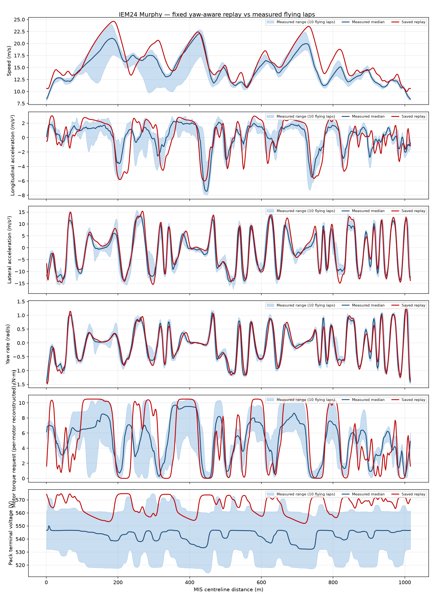
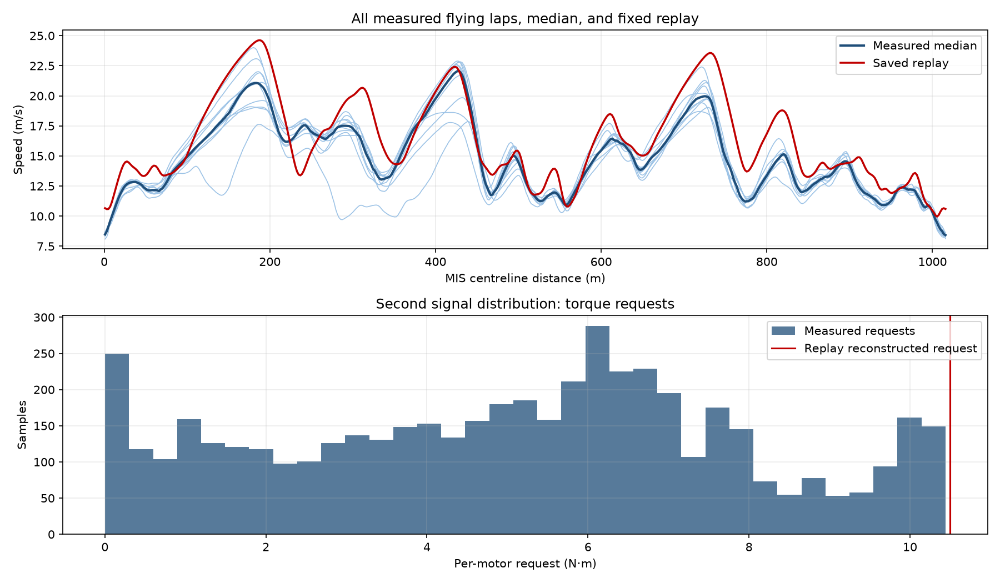
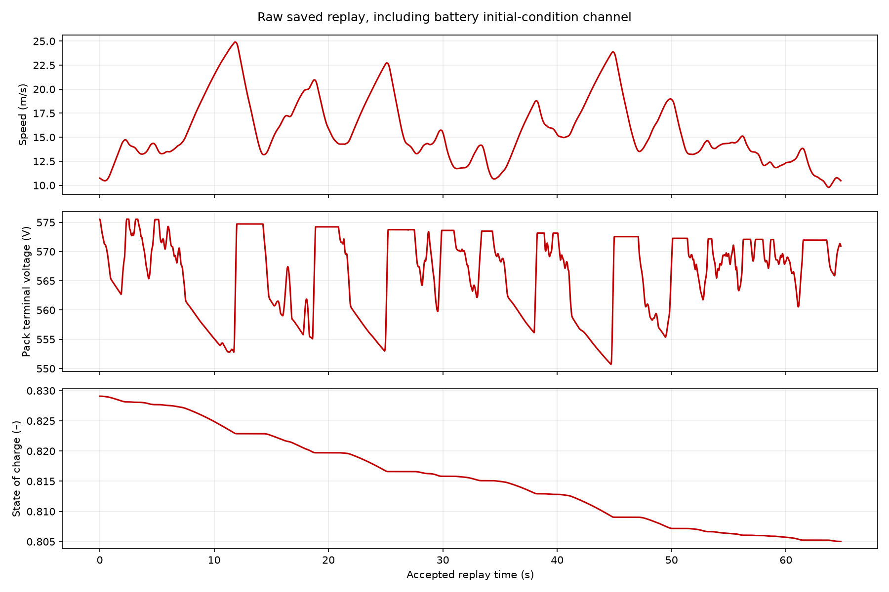

# IEM24 Murphy yaw-aware replay: simulated MIS 2024 lap vs measured endurance stint

## Configuration

- Mass: 287 kg (209 kg car + 78 kg driver); front mass fraction 45 %. CGx is 55 % of the 1.535 m wheelbase behind the front axle (the model's 45 % front static mass fraction); CG height 0.300 m; track width 1.240 m.
- Aero: CL·A = 3.5 m², CD·A = 1.55 m², aero balance 50 % at 1.22 kg/m³.
- Chassis/control: planar 7-DOF `models/formulations/iem24_murphy_real_planar_7dof.xml`; LLTD 42 %, two rear motors, 10.5 N·m controller maximum per motor, 10.9:1 gearing, 95 % drivetrain efficiency, 20 kW per motor and a current compiled motor limit of 1947.787 rad/s (18,600 rpm); mechanical brakes and no reported regeneration. Control limits include 0.5236 rad steering angle, π rad/s steering rate, 1176.8 N maximum pedal force, 0.08 s steering lag, 0.18 s pedal travel / 0.03 s pedal lag, and fixed controller gains preview 0.10, heading 1.8, lateral 2.0, yaw 0.12. The run-record manifest does not embed a current configuration source hash; this is disclosed rather than inferred.
- Initial conditions: recorded initial SOC = 0.829085; recorded initial terminal bus voltage = 575.510 V. Recorded replay initial state is speed components v_x/v_y = 10.699/−0.915 m/s, yaw rate = −1.324 rad/s, heading error = 0.0853 rad and steering = −0.1877 rad; wheel-speed states are plant states. These are nominal plant initial conditions, not fitted to measured telemetry; only the stint-start battery voltage was carried into the compiled battery initialisation.
- Simulated flying lap: exactly 64.802231718 s over 1016.676 m of model path arclength, mapped onto the 1016.701 m reference centreline on `models/tracks/2024_michigan_endurance_closed_edged.xml`, from the saved model-aware forward replay used for the video.

## Measured data

The conditioned cache is `docs/validation/iem24-murphy/measured_stint.csv` (19.9804878 Hz export; original shared log approximately 99.9 Hz). Its extraction metadata is `docs/validation/iem24-murphy/telemetry_extraction.json`; raw source `~/Desktop/0615CompEndurance.mat` is 334513192 bytes, SHA-256 `091e4745a5ff6ccf7d48729154033bb555edd028f0e3e2ed2f3f270e14f6e5b7`. The CSV samples actually consumed span 105.00–913.03 s (the eleven exported laps); extraction's broader driving window is 117.02–925.91 s and segmentation window is 105.00–938.00 s. Channels consumed are body-frame speed, `AccelX`, `AccelY`, `GyroZ`, mean(`Tq_RL_Req`,`Tq_RR_Req`), and `VPack` as documented by the extraction metadata. The cached measured channels were already yaw-rotated and low-pass filtered at 1 Hz with a zero-phase first-order filter; they are **not filtered again**. This applies a rotation/correction to raw navigation data, not a new correction here.

| Lap | Start (s) | Lap time (s) | Driven distance (m) | Mean speed (m/s) | Closure radius (m) |
|---|---:|---:|---:|---:|---:|
| 0 (standing start; excluded) | 105.00 | 85.36 | 1026.7 | 12.03 | 7.21 |
| 1 (flying) | 190.36 | 77.31 | 1020.9 | 13.20 | 0.86 |
| 2 (flying) | 267.67 | 72.58 | 1023.2 | 14.10 | 0.71 |
| 3 (flying) | 340.25 | 73.71 | 1021.6 | 13.86 | 0.18 |
| 4 (flying) | 413.96 | 71.24 | 1020.1 | 14.32 | 0.02 |
| 5 (flying) | 485.20 | 70.01 | 1021.2 | 14.59 | 0.62 |
| 6 (flying) | 555.21 | 74.23 | 1023.0 | 13.78 | 1.60 |
| 7 (flying) | 629.44 | 69.99 | 1023.2 | 14.62 | 0.88 |
| 8 (flying) | 699.43 | 70.92 | 1023.4 | 14.43 | 0.72 |
| 9 (flying) | 770.35 | 72.13 | 1023.2 | 14.19 | 1.13 |
| 10 (flying) | 842.48 | 70.57 | 1021.8 | 14.48 | 0.64 |

All 11 measured laps are listed; lap 0 is the standing start and is flagged/excluded from flying statistics. The ten flying-lap durations have a displayed median of 71.685 s (median of lap times, not an integral of a pointwise-median speed profile). Median measured flying lap: 71.685 s over 1022.4 m, +0.56 % from the 1016.7 m modelled centreline.

### One physical lap axis and conditioning

Measured positions are fitted by a constant translation and projected/folded onto the signed closed centreline; no inferred phase shift or length scaling was applied. Fit offset is +9.97 m north, +3.43 m east; flying-lap centreline residual median/P95 are 0.98/2.45 m. The saved replay has irregular accepted times; each six-channel trace is resampled to uniform 100 Hz, then filtered with the same 1 Hz first-order zero-phase filter before distance interpolation. Its saved plan maps physical station (1016.676 m) to immutable reference centreline station (1016.701 m); cumulative time/sectors honor this station Jacobian and do not treat `1/V` as `dt/ds_reference`; that fixed map, rather than fitted length rescaling, puts replay and measured profiles on the common axis. Raw replay values remain in the record. The navigation yaw-skew correction was 8.550° (IQR 0.304°); extraction reports corrected longitudinal acceleration/velocity-rate correlation 0.984 and RMSE 0.322 m/s², from 0.816 and 1.362 m/s² before the correction.

## Trace comparison

Cumulative per-lap times and sector comparison use monotone unwrapped physical traversals mapped through the saved physical-to-reference Jacobian. Measured lap-boundary elapsed time is preserved; fixed 50 m sectors include the final remainder. `1/V` is not treated as `dt/ds_reference`.

0–50 m: replay 3.890 s, measured 3.499 s, signed gap +0.391 s
50–100 m: replay 3.601 s, measured 3.925 s, signed gap -0.324 s
100–150 m: replay 2.691 s, measured 3.125 s, signed gap -0.433 s
150–200 m: replay 2.112 s, measured 2.675 s, signed gap -0.563 s
200–250 m: replay 3.047 s, measured 3.175 s, signed gap -0.127 s
250–300 m: replay 2.816 s, measured 4.096 s, signed gap -1.280 s
300–350 m: replay 2.832 s, measured 4.799 s, signed gap -1.967 s
350–400 m: replay 2.993 s, measured 4.449 s, signed gap -1.456 s
400–450 m: replay 2.435 s, measured 3.079 s, signed gap -0.644 s
450–500 m: replay 3.486 s, measured 3.949 s, signed gap -0.463 s
500–550 m: replay 3.850 s, measured 4.718 s, signed gap -0.868 s
550–600 m: replay 3.798 s, measured 4.055 s, signed gap -0.257 s
600–650 m: replay 2.996 s, measured 3.324 s, signed gap -0.329 s
650–700 m: replay 2.856 s, measured 3.275 s, signed gap -0.418 s
700–750 m: replay 2.228 s, measured 2.791 s, signed gap -0.563 s
750–800 m: replay 3.198 s, measured 4.099 s, signed gap -0.901 s
800–850 m: replay 3.031 s, measured 3.633 s, signed gap -0.602 s
850–900 m: replay 3.547 s, measured 3.599 s, signed gap -0.052 s
900–950 m: replay 3.714 s, measured 4.324 s, signed gap -0.610 s
950–1000 m: replay 4.081 s, measured 4.388 s, signed gap -0.307 s
1000–1017 m: replay 1.598 s, measured 2.322 s, signed gap -0.724 s
Largest positive: 0–50 m (+0.391 s), 850–900 m (-0.052 s), 200–250 m (-0.127 s), 550–600 m (-0.257 s), 950–1000 m (-0.307 s); largest negative: 300–350 m (-1.967 s), 350–400 m (-1.456 s), 250–300 m (-1.280 s), 750–800 m (-0.901 s), 500–550 m (-0.868 s)

Operational trace availability (full samples: `operational_traces.csv`; unavailable values are left blank):

- requested_motor_torque_per_motor_nm: available (N·m)
- delivered_rear_wheel_torque_nm: available (N·m)
- electrical_bus_power_w: available (W)
- electrical_power_limit_w: unavailable (W) — no configured electrical-limit channel in saved record
- pack_terminal_voltage_v: available (V)
- battery_soc: available (1)
- throttle_saturation: available (1)
- brake_force_n: available (N)
- brake_fraction: available (1)
- brake_saturation: unavailable (1) — actuator saturation state not recorded
- steering_rate_rad_s: available (rad/s)
- steering_rate_saturation: unavailable (1) — actuator saturation state not recorded

The reference is the pointwise median of ten folded flying laps on 500 centreline-distance bins. Bias is `sim − meas`; all units are SI. Body axes are SAE: x forward, y right, z down; positive yaw rate is a right turn.

| Signal | RMSE | MAE | Bias (sim − meas) | Correlation | Normalised RMSE |
|---|---:|---:|---:|---:|---:|
| Speed (m/s) | 2.154 | 1.706 | +1.482 | 0.899 | 0.710 |
| Longitudinal acceleration (m/s²) | 1.598 | 1.268 | -0.086 | 0.758 | 0.886 |
| Lateral acceleration (m/s²) | 2.417 | 1.899 | +0.629 | 0.958 | 0.318 |
| Yaw rate (rad/s) | 0.168 | 0.123 | -0.006 | 0.958 | 0.287 |
| Motor torque request (per-motor reconstructed) (N·m) | 2.998 | 2.497 | +0.171 | 0.679 | 1.127 |
| Pack terminal voltage (V) | 23.612 | 22.625 | +22.625 | 0.341 | 5.454 |







## Reading the comparison

- The replay is **6.883 s faster** (-9.60 % relative to the measured median): 64.802 s against 71.685 s. Its mean centreline speed follows from time over the modelled centreline; this descriptive relationship is not a causal diagnosis. This is one strict feasible forward replay, not an optimum; the comparison does not establish why it differs.
- Speed RMSE is 2.154 m/s (bias +1.482 m/s; correlation 0.899). Longitudinal/lateral acceleration RMSE is 1.598/2.417 m/s²; yaw-rate RMSE is 0.168 rad/s.
- Reconstructed per-motor torque request RMSE is 2.998 N·m. It is exactly `realized throttle × 10.5 N·m` for the reporting controller limit: reconstructed request before electrical/speed limits, distinct from delivered motor torque and actual signed `wheel-drive-torque` (gear ratio/efficiency convention). Changing this reporting limit changes only reconstructed request; delivered torque stays as recorded. Electrical power limits, SOC/voltage and saturation are not collapsed into that request. The manifest's `wheel-drive-torque` is actual wheel torque and is deliberately not relabelled as request; this distinction and any power-limit effect limit interpretation.
- Pack terminal-voltage RMSE is 23.612 V with bias +22.625 V. The replay starts from stint-start SOC/voltage while flying laps span discharge, so this contains an initial-condition offset as well as trace differences.
- The -6.883 s gap (-9.60 %) is historical context, not causal attribution: retained provenance does not identity-match historical plans/records or Task9 pairs, so all five controlled treatments are not run/inconclusive. The displayed median is the median of 10 flying-lap durations (71.685 s), not the integral of a pointwise-median speed curve; lap 0 remains standing-start and excluded. Interactions remain unresolved.

### Controlled ablation status

| Treatment | Held-fixed identities | Driven time | Six-channel metrics | Status / limitations |
|---|---|---:|---|---|
| Controller legacy vs final model-aware | Identity unknown | not run | not run | Inconclusive: no identity-matched control pair. |
| Fixed vs optimized line | Identity unknown | not run | not run | Inconclusive: Task9 paired comparisons identity-inconclusive. |
| Battery initialisation response | Identity unknown | not run | not run | Current/state inputs unavailable; terminal voltage is not OCV. |
| Tire-force scale 0.95 / 1.05 | Identity unknown | not run | not run | No rebuilt/audited maps and replans; replay-only is robustness only. |
| Alignment ±1 bin and leave-one-lap-out | Physical lap times unchanged | not run | not run | Source geometry/provenance inconclusive; no best-shift correction. |

No causal effects are added or summed; interactions remain unresolved.

## Caveats

- **These are the values we did not measure** for this car: wheelbase and track width confirmation for this log, CG height and yaw/wheel inertia, tire force/slip and transient-tire parameters, battery capacity/resistance map, motor/drivetrain efficiency, brake and steering dynamics, air density, aero coefficients/balance, and brake bias. They are carried over/model calibrations, not identified from this stint.
- Raw-source provenance is verified by SHA-256 when `~/Desktop/0615CompEndurance.mat` is accessible; the generator hashes it when accessible but does not re-extract it because comparison uses the already-extracted cache. Cache SHA-256 is `795d37a904302f712bab1fa1809dbd838c4cb9c0db3e60c9215561487d6c3d2b` and extraction hash is `ee79539cc2736d881b6752a32ba959d7bbf14c89c8baa5fc0a51317081edc341`. If the raw source is unavailable on another machine, that is disclosed in metrics rather than blocking use of the cache.
- The saved record has SHA-256 `38fb555f097b00959f397915937615fc05aa0ac25534ce179474c048bc8bba01` (19656566 bytes). Its manifest identifies controller/track content but not a configuration-source hash; no claim is made that the current XML is embedded in that historical record.
- The record says `lap_completed=true`; the replay is strict-solver feasible, not an optimum. Its saved yaw-profile artifact records eight refinement rounds and resolution convergence; that 1 m planning-profile status does not certify a continuous mesh or this forward replay as optimal. Containment is sampled-centre contained, while footprint and between-step containment are not certified.
- Measurement position is dead-reckoned from velocity. Residual centreline offset, the battery initial-condition mismatch, and request-versus-delivered torque convention are separate from structural model error.
- The track XML metadata traces its reference geometry to the same MAT source (SHA-256 `091e4745a5ff6ccf7d48729154033bb555edd028f0e3e2ed2f3f270e14f6e5b7`); it is reconstructed from this log rather than an independent surveyed edge geometry. The 2.25 m assumed corridor is likewise not surveyed, so this is not independent geometry validation.

## Reproduce

```bash
PYTHONPATH=src:. MPLCONFIGDIR=/tmp/matplotlib-config \
  python3 tools/run/run_with_deadline.py --seconds 300 -- \
  python3 tools/reports/compare_yaw_mis_replay.py \
  --record runs/yaw_lap_suite/mis-modelaware-matchedpreview-validated/run_record.npz \
  --plan runs/yaw_lap_suite/mis-fixed-1m/plan.npz \
  --measured-dir docs/validation/iem24-murphy \
  --output-dir docs/validation/iem24-murphy-yaw-closure
```

Generated by `tools/reports/compare_yaw_mis_replay.py` following the [MIS 2024 report standard](../../standards/mis-2024-report-standard.md). The command consumes one saved record and cached measured telemetry; it does not rerun physics or OCP.
