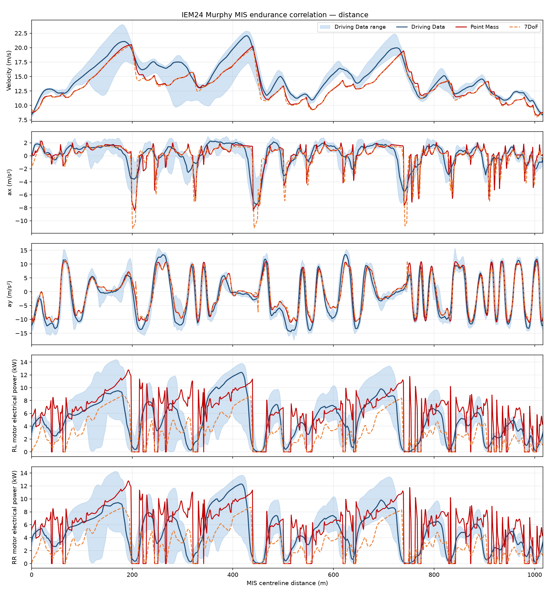
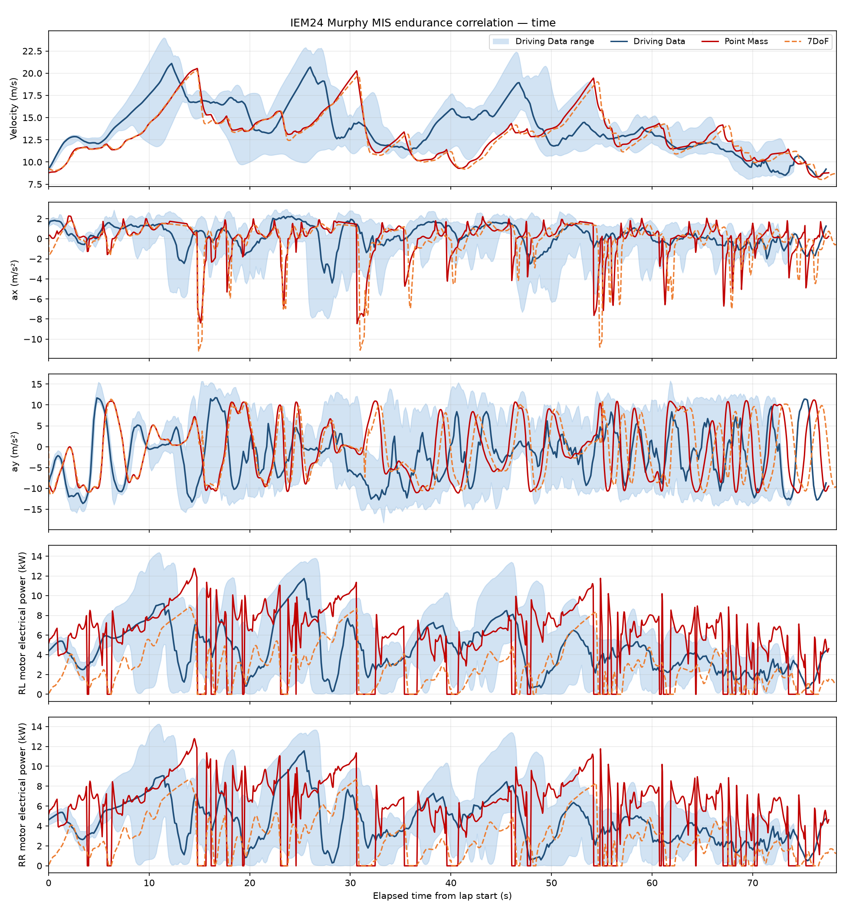

# IEM24 Murphy comparison (historical OCP claim unverified)

> **Tools layout migration note.** `tools/` was reorganised into category subpackages (`data`, `tracks`, `model_data`, `run`, `gates`, `reports`, `diagnostics`). Commands and paths in this document use the current locations; See [docs/dev/tools-layout.md](../../dev/tools-layout.md) for the old-to-new mapping. Recorded hashes, attempt directories and frozen artifacts are unchanged.

> **Verification status:** The planar 7-DOF OCP API has been retired from the
> current tree and is not supported. The saved 20 m / 52-node `Solve_Succeeded`
> result (53.967 s) is historical only, not a validated prediction. Its coarse
> geometry is invalid as documented in `docs/validation/planar-ocp.md`; solver
> convergence and saved trace metrics do not establish a usable lap. Accordingly,
> this artifact is not a current three-way comparison: only measured telemetry
> and the point-mass result remain usable here. Historical OCP data and plots are
> retained for provenance, but all OCP-derived metrics below are unverified.

Measured telemetry remains unchanged. The pack-voltage panel plots terminal-voltage change from each trace's own lap start, so all three start at zero and the mid-stint measured pack voltage offset is removed.

The point-mass run uses the real IEM24 parameter set and measured rear-drive controller configuration. The archived 7DoF curve comes from `current_7dof_live_trials/attempt_1792053802530251000`, on the **legacy original track** and an **earlier provisional tire and load-solver source snapshot**; it is not the final 7DoF model or either newer track-pair acceptance lap. The historical run used the same mass, CG, LLTD, aero, rear-only topology, battery initial SOC, and 10.5 N·m torque cap. Its combined-slip UniTire used provisional surface-mu scaling informed by measured peak deceleration/cornering (not a tire re-fit), while its smooth motor envelope approximated the measured map. Parallel steering, 3.5 in/rev Narco rack travel, and 65% front brake bias are user-confirmed; steering-arm/rate and hydraulic/pedal details remain provisional. The virtual brake request was extended only as needed to reach that run's hydraulic pressure cap. The historical curve and its correlation values must not be used to assess the final tire, solver, or canonical-track laps; see [the later paired-track acceptance chronology](seven_dof_track_pair/acceptance_gate_trials.md).

- Measured flying laps: 10; median lap time 71.685 s.
- Point-mass lap: 77.561 s (converged: True).
- Planar 7DoF OCP: **historical/unverified**; the saved 53.967 s / `Solve_Succeeded` entry is not a usable lap-time claim because its 20 m geometry is invalid.

## Five-channel correlation panels

The two images each contain velocity, body-frame ax and ay, and separate rear-left (RL)
and rear-right (RR) motor power, in that order. Shading is the minimum-to-maximum
range of the ten measured flying laps; the blue curve is their median. The distance
image uses nearest-centreline projection and periodic lap folding. The time image
uses elapsed time from each lap's own start **without stretching or phase matching**;
shorter measured laps cease contributing after they end. Therefore time-aligned
corners naturally drift between models as their lap times differ.

The measured `pwrRLReal` and `pwrRRReal` channels in
`~/Desktop/0615CompEndurance.mat` are per-motor real **electrical** power in W,
conditioned with the same zero-phase first-order 1 Hz Butterworth filter and
20 Hz exported timestamps as the other telemetry, then converted to kW.
The point-mass export does not contain electrical motor power: its model
curves **estimate** each rear motor's electrical input as
`APPS_fraction × 10.5 N·m × 10.9 × velocity / 0.193675 m / 0.79`, divided by
1000 to express kW. This assumes equal rear-motor requests, negligible wheel
slip and a fixed 79% efficiency estimated from the MAT log. The new 7DoF power
curves are instead reconstructed from each driven wheel's motor torque and wheel
angular speed, with the model's gearbox and motor efficiencies; these are model
estimates rather than measured electrical channels.

The dashed 7DoF curves now use a **new live-limit transient forward-driver
run** from the current 7DoF plant, not the historical unconverged OCP iterate
or the earlier conservative 8 m/s run. BDF integration completed a full
1016.701 m lap in 78.311 s (25,338 accepted steps, 85,608 solver evaluations;
165.51 s wall time, under the 300 s cap). The live plan uses the planar-derived
point-mass UniTire peak envelope and motor/battery limits with a 60 m/s maximum
speed setting, **no imposed lateral-acceleration cap**, and a 0.175 s pedal
travel-time limiter. The 7DoF velocity trace has 0.353 m/s distance-aligned
RMSE and 0.994 correlation against the separate 77.561 s point-mass run; these
models are close, but not identical. The driven lap is **not a minimum-time
optimum**. Although path error stayed below 0.230 m and evaluated physics
checks passed, `usable: false`: seam periodicity fails, and between-step and
refinement validation remain incomplete. No wheel lift or inverter-speed
taper occurred in this particular run. Run summary, exact settings, source
hashes and raw state/pedal traces are in
`current_7dof_live_trials/attempt_1792053802530251000/`.





Reproduce these panels from the repository root with:

```bash
PYTHONPATH=src:/tmp/casadi_pkgs python3 tools/run/run_iem24_forward_driver.py \
  --planner live --maximum-speed 60 --method BDF \
  --output-root docs/validation/iem24-murphy/current_7dof_live_trials
# Replace the attempt id below with the newly printed id if rerunning.
PYTHONPATH=src:/tmp/casadi_pkgs python3 tools/reports/export_iem24_forward_correlation.py \
  docs/validation/iem24-murphy/current_7dof_live_trials/attempt_1792053802530251000
PYTHONPATH=src:. MPLCONFIGDIR=/tmp/matplotlib-config \
  python3 tools/reports/plot_iem24_endurance_correlation.py \
  --seven-dof docs/validation/iem24-murphy/current_7dof_live_trials/attempt_1792053802530251000/simulated_lap_7dof.csv
```

The MAT file is local and must be supplied separately; use `--mat /path/to/0615CompEndurance.mat` if it is not on the Desktop. These panels supplement, rather than replace, the required figures in the [MIS 2024 report standard](../../standards/mis-2024-report-standard.md).


The per-signal metrics and shared traces remain archived in `comparison_three_way_summary.json` and `comparison_three_way.csv`; planar OCP entries in both are historical/unverified and must not be interpreted as current comparison evidence.
