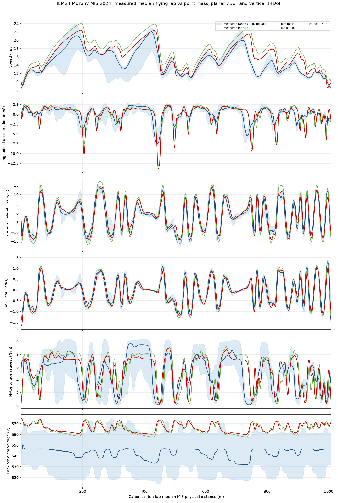
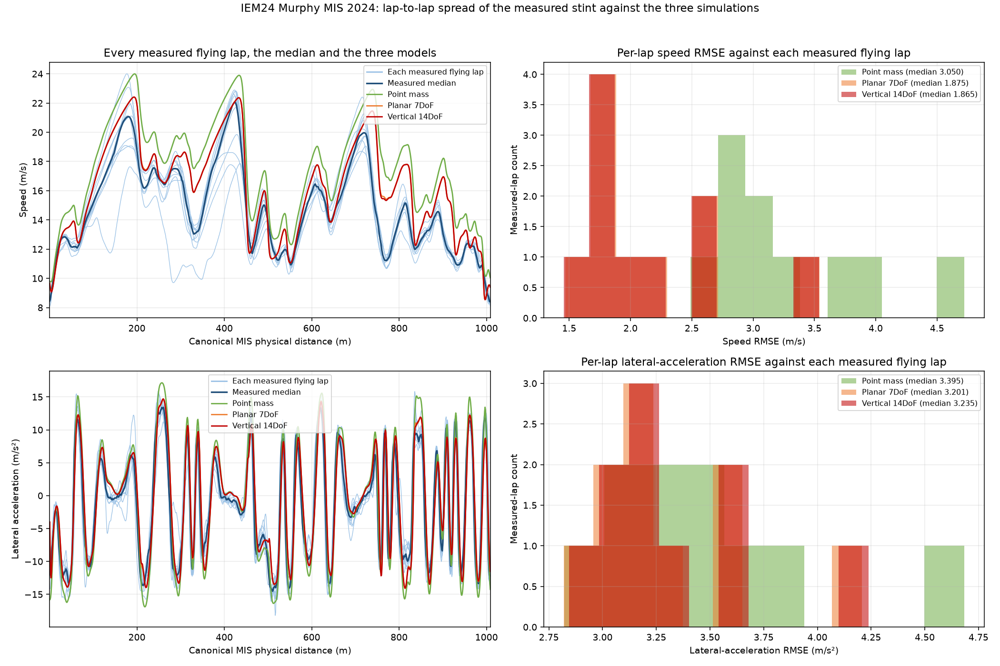
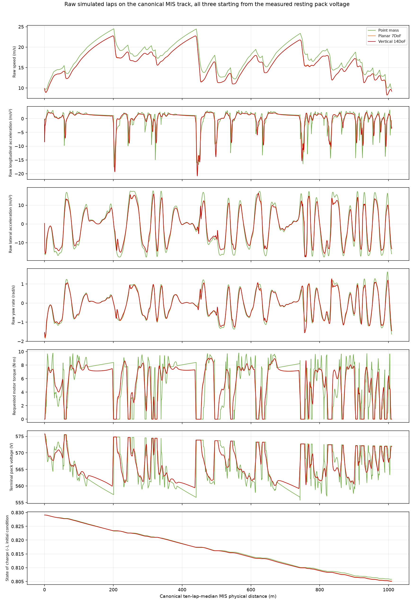
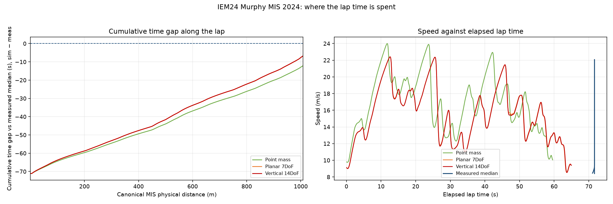

# IEM24 Murphy MIS 2024 four-way comparison: measured endurance stint vs point-mass, planar 7DoF and vertical 14DoF simulated laps

Michigan International Speedway 2024 endurance circuit, the IEM24 Murphy car, **three simulated laps compared with one measured endurance stint**. This report follows the [MIS 2024 report standard](../../../standards/mis-2024-report-standard.md) **with one departure, stated here as the standard requires**: the standard describes a single simulation (one simulation colour, one simulation per metric row), and this report deliberately compares **three** — the energy-coupled minimum-time point mass, the planar 7DoF forward-driver lap and the vertical 14DoF forward-driver lap — because the question asked is how the newest 14DoF model ranks against the two models already in the repository on one common track. The departure is limited to (i) three distinguishable simulation colours instead of one, (ii) one metric table carrying a `Model` column, and (iii) a fourth comparison figure (`time_gap.png`) plus a model-vs-model table. Sections, channels, columns, units, sign conventions, disclosures and figures otherwise follow the standard unchanged. All three simulations are fresh runs on the canonical ten-lap-median track `models/tracks/2024_michigan_endurance_multilap_closed.xml` with the current checked-in vehicle, tire and formulation files (commit `1e1346a` corrected the track width to 1.240 m and the front mass fraction to 45 %); no earlier report's numbers are reused. **No claim of validation is made:** the measured lap is a human driven lap and the two forward laps are non-optimal driven transients; both forward attempts pass the numerical acceptance gates (table in Configuration); that is numerical acceptance, not physical validation.

## Configuration

All three simulations share one physical model of the car, one measured-driver plan and one track. Values below are compiled from the current files; the formulations are `models/formulations/iem24_murphy_real_planar_7dof.xml` (point mass and planar 7DoF) and `models/formulations/iem24_murphy_real_14dof_simple.xml` (vertical 14DoF).

- Mass: **287 kg** (209 kg car + 78 kg driver), identical in all three runs. Yaw radius of gyration 0.679366 m (measured yaw inertia), wheel inertia 0.2065 kg·m² per wheel. The vertical 14DoF splits this into a 235 kg sprung body and 52 kg unsprung (13 kg per front corner, 13 kg per rear corner); the point mass and the planar 7DoF carry no vertical split.
- Chassis: wheelbase 1.535 m, track width 1.24 m, LLTD 42 %, **CGx** = 45 % of the mass on the front axle (0.8443 m behind the **front** axle), CG height 0.3 m, 65 % front mechanical brake bias. The vertical model's sprung CG sits 0.321132 m up with a sprung front fraction of 0.438936; unsprung CG height 0.2045 m.
- Vertical inertias (14DoF only): pitch inertia 35.014060 kg·m² (radius of gyration 0.386 m, the user-reported D5 value), roll inertia 8.753515 kg·m² (radius 0.193 m). Both radii are **unvalidated**; see Caveats.
- Aero: air density 1.22 kg/m³, CL·A = 3.5 m², CD·A = 1.55 m², aero balance 50 %.
- Drivetrain: 2 rear motors, 10.5 N·m per-motor torque cap, 20 kW per motor, 10.9:1 gear ratio, regeneration off; full pedal requests 10.5 N·m per motor. Tire: UniTire (`models/tires/iem24_murphy_real_unitire.xml`) with a peak/sliding friction envelope μ₀ₓ = 1.557442, μₛₓ = 1.343961, μ₀ᵧ = 1.586920, μₛᵧ = 1.369043; the vertical model additionally uses the PROPOSED transient tire layer (length scales 1 / 1 m, trail pole/lead 1 / 0.25) whose coefficients are **not fitted** to this tire.
- Battery: 144s1p, 200 A discharge limit, 14.146 Ah per cell, SOC-dependent OCV and resistance from the cell curves.
- Initial conditions (all three runs): initial SOC 0.829085 from the measured resting pack voltage 575.70 V before launch (initial bus voltage 575.7 V); first accepted forward speed 9.186 m/s (planar 7DoF), 9.181 m/s (14DoF), and the point mass solves its own periodic flying-lap start speed 9.830 m/s. No measured tire temperature or ambient state initialises any run.
- Simulated laps on `models/tracks/2024_michigan_endurance_multilap_closed.xml` (length 1009.195 m): point mass **59.620 s**, planar 7DoF **64.952 s**, vertical 14DoF **65.010 s**. Measured median flying lap **71.685 s** (1022.40 m driven).

Per-model differences (all on the same canonical track):

| Property | Point mass | Planar 7DoF | Vertical 14DoF |
|---|---|---|---|
| Degrees of freedom | 3 (path speed, rear-drive force, energy) | 7 planar (v_x, v_y, yaw, four wheel speeds) | 14 (planar 7 + heave, roll, pitch, four jounces) |
| Tire model | peak/sliding pure-slip envelope from the UniTire lab fit | steady UniTire combined slip with four wheel-speed states | the same steady UniTire plus the PROPOSED transient (relaxation) layer |
| Suspension / vertical load | none; a quasi-static load-transfer-free grip limit | none; per-wheel load from quasi-static lateral/longitudinal transfer | four-corner springs, bump stops, ARB, dampers (5/7 clicks), jounce travel -0.0318–0.0318 m, roll-centre table from real car data |
| Driver | prescribed-path minimum-time optimum (no driver) | preview driver on the live point-mass speed plan | same preview driver and plan as the 7DoF |
| Solver | energy-coupled forward/backward profile iterations | BDF, rtol 2.5e-06, maximum step 0.005 s | BDF, rtol 1.25e-06, maximum step 0.000625 s |
| Path spacing | 0.5 m mesh, 2020 nodes | 0.5 m plan | 0.5 m plan |
| Lap-run status | converged in 3 profile and 3 energy iterations | completed full lap, accepted steps 19253, wall 196.0 s, peak RSS 0.60 GB | completed full lap, accepted steps 106281, wall 576.4 s, peak RSS 6.62 GB |
| `usable` verdict | not applicable (not a driven lap); optimum | **PASS** | **PASS** |

Acceptance gates recorded by the two forward attempts (the point mass records convergence, not these gates):

| Gate | Planar 7DoF | Vertical 14DoF |
|---|---|---|
| Full lap completed | PASS | PASS |
| Integration completed | PASS | PASS |
| Periodic closure (end state = start state) | PASS | PASS |
| Path tracking (lateral error ≤ 0.25 m) | PASS | PASS |
| Accepted spatial step resolution | PASS | PASS |
| Physics checked at every accepted state | PASS | PASS |
| Between-step validation | PASS | PASS |
| Refinement validated | PASS | PASS |
| Tire contact loads non-negative | PASS | PASS |
| **Recorded `usable` verdict** | **PASS** | **PASS** |

Model inputs and their recorded SHA-256 (re-verified against the files on disk and against each attempt's `source_snapshot` before this report was written; the attempted runs and the export all agree):

| Input | Path | SHA-256 |
|---|---|---|
| track_xml (Point mass, Planar 7DoF, Vertical 14DoF) | `models/tracks/2024_michigan_endurance_multilap_closed.xml` | `ffc367c0286ba698f3706ae8baf34946c641c01ad4f71935d3ec14a3a326f2c3` |
| track_csv (Point mass, Planar 7DoF, Vertical 14DoF) | `models/tracks/2024_michigan_endurance_multilap_closed.csv` | `2db5a981f12d0c055afa3b167a9e6efa07cd09b1f6e7b2c51afea44f00e73d77` |
| tire_xml (Point mass, Planar 7DoF, Vertical 14DoF) | `models/tires/iem24_murphy_real_unitire.xml` | `301c55c8213fd9a4149bdec39a8c6fbc6a756e750bd6bd92e80b6567bcbd917b` |
| formulation_xml (Point mass, Planar 7DoF) | `models/formulations/iem24_murphy_real_planar_7dof.xml` | `8420c2d4e929f629c52fb9a21e1b1e5d047bf2356615d3edfc0a8e95bf6878d8` |
| formulation_xml (Vertical 14DoF) | `models/formulations/iem24_murphy_real_14dof_simple.xml` | `6e6bbb00601845781ccc679845cc4fd95f42770fdd5eb7456dd73d52f26b8bda` |
| vehicle_xml (Point mass, Planar 7DoF, Vertical 14DoF) | `models/vehicles/iem24_murphy_real_planar.xml` | `f7e75a7b0b8a59cb7acd17060d021d73de88e7e8cce8cad1cb8c3400715bd03f` |

The point-mass run records the track and formulation by hash rather than by `model_inputs`; its tire and vehicle reach the solve through `models/formulations/iem24_murphy_real_planar_7dof.xml`, whose compiled parameters are the same objects the planar 7DoF report compiles.

## Measured data

Source `/Users/alphabet1671/Desktop/0615CompEndurance.mat`, SHA-256 `091e4745a5ff6ccf7d48729154033bb555edd028f0e3e2ed2f3f270e14f6e5b7`, 334513192 bytes; shared log clock 100 Hz (222394 samples), exported measured table at 19.98 Hz. Conditioning uses 105.00–938.00 s for lap identification and a 117.02–925.91 s driving window. Channels consumed: navigation `VNorth`, `VEast`, `VelX`, `VelY`, `AccelX`, `AccelY`, `GyroZ`; per-motor requests `Tq_RL_Req`, `Tq_RR_Req`; pack voltage `VPack`. The existing `measured_stint.csv` and `telemetry_extraction.json` are read unchanged and were not regenerated by this report.

Corrections applied to the raw channels: the 8.55° navigation-unit yaw skew rotates VelX/VelY and AccelX/AccelY into the body frame (corrected longitudinal-acceleration-versus-velocity-rate RMSE 0.322 m/s², correlation 0.984); the motor torque request is the mean of the two logged per-motor requests; navigation accelerations, speed, torque and voltage are low-pass filtered with a zero-phase first-order filter at **1 Hz** (cutoff 1 Hz, order 1, `sosfiltfilt` on a 100 Hz uniform clock for the simulated traces). No voltage zeroing, no inferred time shift and no equal-length scaling is applied to any trace in the metric table; the only offset convention used elsewhere in the repository — the three-way tool's per-lap pack-voltage zeroing, which subtracts each lap's first sample — is **not** applied here, and its effect is quantified in `Reading the comparison` so the residual offset can be separated from model error.

| Lap | Start (s) | Lap time (s) | Driven distance (m) | Mean speed (m/s) | Closure radius (m) |
|---|---|---:|---:|---:|---:|
| 0 (standing start) | 105.00 | 85.36 | 1026.7 | 12.03 | 7.21 |
| 1 (flying) | 190.36 | 77.31 | 1020.9 | 13.20 | 0.86 |
| 2 (flying) | 267.67 | 72.58 | 1023.2 | 14.10 | 0.71 |
| 3 (flying) | 340.25 | 73.71 | 1021.6 | 13.86 | 0.18 |
| 4 (flying) | 413.96 | 71.24 | 1020.1 | 14.32 | 0.02 |
| 5 (flying) | 485.20 | 70.01 | 1021.2 | 14.59 | 0.62 |
| 6 (flying) | 555.21 | 74.23 | 1023.0 | 13.78 | 1.60 |
| 7 (flying) | 629.44 | 69.99 | 1023.2 | 14.62 | 0.88 |
| 8 (flying) | 699.43 | 70.92 | 1023.4 | 14.43 | 0.72 |
| 9 (flying) | 770.35 | 72.13 | 1023.2 | 14.19 | 1.13 |
| 10 (flying) | 842.48 | 70.57 | 1021.8 | 14.48 | 0.64 |

Median of the 10 flying laps: **71.685 s** over **1022.40 m** (14.26 m/s mean). The measured driven line is +1.31 % longer than the 1009.20 m canonical modelled centreline. The standing-start lap is in the table and excluded from every statistic.

Alignment: each measured position is projected onto the canonical centreline after fitting a constant north/east translation (fit RMSE 1.47 m, residual p95 2.28 m; offset north +9.79 m, east +3.35 m). Every flying lap is then interpolated onto the canonical track's own physical distance (integrated path coordinate `s` for the simulations, projected distance for the measurement) and the median and full range are recomputed on a 1009-point grid. All four traces therefore share one physical distance axis; **no phase offset is inferred and no trace is stretched**, because all four laps close on the same 1009.195 m line.

Channel definitions, identical for the planar 7DoF and the vertical 14DoF: speed is the body-frame velocity magnitude `hypot(v_x, v_y)`; longitudinal and lateral acceleration are road-plane body-frame accelerations including the rotating-frame terms (`v_x_dot − yaw_rate·v_y` and `v_y_dot + yaw_rate·v_x`) — the road is flat, so body-frame and road-plane definitions coincide and no roll/pitch gravimetric projection is modelled; yaw rate is the traced `yaw_rate` state; motor torque request is the commanded pedal fraction times the 10.5 N·m per-motor full-pedal limit (requested, not delivered); pack terminal voltage is the plant's own terminal-voltage closure. The point-mass model has no yaw state, wheel speeds or motor command in the same sense, so its channels come from its existing exporter exactly as in `point_mass_track_pair/report.md`: yaw rate is the kinematic `a_y / v` of the prescribed path, motor torque request is reconstructed from the driven rear-wheel force through the gear ratio and transmission efficiency and clipped at 10.5 N·m (zero while braking), pack terminal voltage is reconstructed from the solver's bus power and SOC with the library battery model, and its SOC trace is reconstructed by integrating `I = P/V` — that reconstruction reproduces the solver's recorded final SOC to 0.14 % of the SOC drop. Point-mass `rl_power_kw`/`rr_power_kw` are equal halves of the total bus power, so its power channels are not independent per-motor measurements.

## Trace comparison

Every model is scored against the **median of the same 10 flying laps** on the shared 1009-point canonical distance grid. Measured range shading is the minimum and maximum individual flying-lap value. Bias is signed **sim − meas** in the row's unit. The two forward laps are single transients from their own initial states (periodic closure gate: planar 7DoF PASS, vertical 14DoF PASS; closure is within the gate tolerance, not exact), so their start and end samples are not exactly steady-state; the point mass is a converged periodic optimum on the same geometry.

| Signal | Model | RMSE | MAE | Bias (sim − meas) | Correlation | Normalised RMSE |
|---|---|---:|---:|---:|---:|---:|
| Speed (m/s) | Point mass | 3.019 | 2.691 | +2.691 | 0.913 | 0.997 |
| Speed (m/s) | Planar 7DoF | 1.817 | 1.371 | +1.297 | 0.921 | 0.600 |
| Speed (m/s) | Vertical 14DoF | 1.800 | 1.362 | +1.284 | 0.923 | 0.594 |
| Longitudinal acceleration (m/s²) | Point mass | 1.754 | 1.162 | -0.101 | 0.710 | 0.969 |
| Longitudinal acceleration (m/s²) | Planar 7DoF | 1.823 | 1.136 | -0.112 | 0.698 | 1.007 |
| Longitudinal acceleration (m/s²) | Vertical 14DoF | 1.845 | 1.145 | -0.115 | 0.696 | 1.019 |
| Lateral acceleration (m/s²) | Point mass | 2.917 | 2.471 | +0.358 | 0.959 | 0.385 |
| Lateral acceleration (m/s²) | Planar 7DoF | 2.693 | 2.149 | +0.527 | 0.940 | 0.355 |
| Lateral acceleration (m/s²) | Vertical 14DoF | 2.711 | 2.162 | +0.534 | 0.939 | 0.358 |
| Yaw rate (rad/s) | Point mass | 0.181 | 0.141 | -0.016 | 0.953 | 0.311 |
| Yaw rate (rad/s) | Planar 7DoF | 0.211 | 0.155 | -0.010 | 0.932 | 0.362 |
| Yaw rate (rad/s) | Vertical 14DoF | 0.213 | 0.158 | -0.009 | 0.931 | 0.367 |
| Motor torque request (N·m) | Point mass | 2.453 | 1.818 | +0.231 | 0.605 | 0.921 |
| Motor torque request (N·m) | Planar 7DoF | 2.008 | 1.511 | +0.236 | 0.700 | 0.754 |
| Motor torque request (N·m) | Vertical 14DoF | 2.018 | 1.518 | +0.264 | 0.696 | 0.757 |
| Pack terminal voltage (V) | Point mass | 23.010 | 22.532 | +22.532 | 0.486 | 5.305 |
| Pack terminal voltage (V) | Planar 7DoF | 19.929 | 19.400 | +19.400 | 0.396 | 4.595 |
| Pack terminal voltage (V) | Vertical 14DoF | 19.858 | 19.324 | +19.324 | 0.391 | 4.578 |

Lap-time summary (sign convention sim − meas against the measured median flying lap):

| Source | Lap time (s) | Gap vs measured median (s) | Mean speed (m/s) |
|---|---:|---:|---:|
| Measured median of 10 flying laps | 71.685 | 0.000 | 14.262 |
| Measured fastest / slowest flying lap | 69.990 / 77.310 | — | — |
| Point mass | 59.620 | -12.065 | 16.927 |
| Planar 7DoF | 64.952 | -6.733 | 15.538 |
| Vertical 14DoF | 65.010 | -6.675 | 15.524 |

Model-to-model agreement on the same grid (point mass minus the listed model, so a positive bias means the point mass is faster at that distance):

| Pair | Speed RMSE (m/s) | Speed MAE (m/s) | Speed bias (m/s) | 1 − var(difference)/var(second) |
|---|---:|---:|---:|---:|
| Point mass − planar 7DoF | 1.441 | 1.394 | +1.394 | 0.9875 |
| Point mass − vertical 14DoF | 1.461 | 1.407 | +1.407 | 0.9853 |
| Planar 7DoF − vertical 14DoF | 0.042 | 0.016 | +0.013 | 0.9999 |









## Reading the comparison

- **Lap time: all three models are faster than the measured median lap, by 12.06 s (point mass, 59.620 s), 6.73 s (planar 7DoF, 64.952 s) and 6.67 s (vertical 14DoF, 65.010 s) against 71.685 s.** The mean speeds are 16.93, 15.54 and 15.52 m/s against 14.26 m/s measured. **The headline result is that the vertical degrees of freedom change almost nothing.** The 14DoF lap is +0.058 s against the planar 7DoF (+0.09 %), and their two speed traces differ by 0.042 m/s RMSE on the shared grid, while each is roughly 6.7 s from the measured median: adding suspension load transfer, four-corner vertical dynamics and transient tire relaxation moves the answer by less than a tenth of a second, so **the 6.7 s gap to the measured lap is not explained by the vertical fidelity the 14DoF adds**. The point mass is 5.33 s faster than the planar 7DoF because it is a prescribed-path **minimum-time optimum** with no driver, no transient wheel dynamics and no steering lag — it is a bound, not a lap a driver could repeat. The fact that all three beat the measured median means the shared grip and powertrain priors (μ₀ᵧ = 1.587, i.e. the 2/3-of-lab road prior) are optimistic for this track on this day; the deficit is a **model/prior** effect, not an alignment or initial-condition effect. All three models completed a full lap on the canonical track, so no legacy-track fallback table is needed.
- **Speed:** RMSE 3.019 (point mass), 1.817 (planar 7DoF) and 1.800 m/s (vertical 14DoF); biases +2.691, +1.297 and +1.284 m/s; correlations 0.913, 0.921 and 0.923. All three track the measured shape well, and all three sit **high** on average: the models carry more speed through the corner exits than the measured median. Peak speed is 24.0 / 22.4 / 22.4 m/s simulated against 22.1 m/s in the measured median. The point mass is the unfavourable extreme here: its mean bias is +2.69 m/s, more than twice the forward models' +1.30 / +1.28 m/s, because a minimum-time optimum is a different kind of object from a driven lap.
- **Longitudinal acceleration:** RMSE 1.754 / 1.823 / 1.845 m/s² (point mass / 7DoF / 14DoF) with correlations 0.710 / 0.698 / 0.696. After 1 Hz filtering the models brake to -13.3 / -13.5 / -13.9 m/s² against -7.5 m/s² in the measured median: every model brakes harder and later than the human driver, which is where a large part of the lap-time gap is won. This row is the one where the models are individually worst (normalised RMSE 1.01), and the cause is the driver model (instantaneous torque switching against the human pedal ramp), not the vehicle model: the 7DoF and 14DoF rows are within 0.022 m/s² of each other.
- **Lateral acceleration:** RMSE 2.917 / 2.693 / 2.711 m/s² with biases +0.358 / +0.527 / +0.534 m/s². Peak |a_y| is 17.1 m/s² for the point mass (1.75 g, above the measured median's 14.5 m/s² and near the stint's individual peak of 18.4 m/s²) but only 14.7 / 14.7 m/s² for the two driven models, which match the measured median's cornering peaks closely. The positive bias in every model is at least partly the known measured-accelerometer offset (the point-mass pair report found measured a_y about −0.7 m/s² away from `v·yaw`), not pure model error: RMSE and correlation are the safer agreement measures here.
- **Yaw rate:** RMSE 0.1810 / 0.2108 / 0.2134 rad/s and biases -0.0155 / -0.0097 / -0.0095 rad/s. The two driven histories trace the measured yaw closely (0.932 and 0.931 correlation); the point-mass yaw rate is a kinematic `a_y / v` derived from a lateral acceleration that is itself quantised at the mesh, so its higher error (0.1810 rad/s) is an export artefact of the prescribed-path optimum, not a handling result.
- **Motor torque request:** RMSE 2.453 / 2.008 / 2.018 N·m with biases +0.231 / +0.236 / +0.264 N·m and mean requests 5.35 / 5.35 / 5.38 N·m against 5.12 N·m measured. **Definition difference, disclosed:** the point-mass row is a torque reconstructed from the driven rear-wheel force (so it is zero under braking and reaches the 10.5 N·m clip), while the two forward rows are the commanded pedal fraction times 10.5 N·m. The three rows are therefore not the same measurement and must not be ranked against each other; the measured channel is the logged mean of `Tq_RL_Req` and `Tq_RR_Req`, whose peak is 10.45 N·m.
- **Pack terminal voltage (reconstructed):** RMSE 23.010 / 19.929 / 19.858 V and biases +22.53 / +19.40 / +19.32 V. **This row is dominated by an initial-condition difference, not by model structure.** The simulations all start at the stint-start SOC 0.829085 (the measured resting pack voltage 575.70 V), while the ten measured flying laps start from a median boundary voltage of 550.65 V, i.e. part-way through the discharge. Applying the three-way tool's per-lap voltage-zeroing convention (subtract each trace's first sample) reduces the bias to -6.35 / -5.41 / -5.46 V, and removing the mean offset alone leaves a shape-only RMSE of 4.668 / 4.560 / 4.576 V. The metric table above keeps the **absolute** voltage (the standard's convention here, and the one the 7DoF paired-track report uses), so its voltage RMSE and bias must be read as an offset plus a shape error; the shape error is the only part that speaks about the battery model.
- **Spread:** the per-lap speed RMSE against the individual flying laps spans 2.644–4.567 m/s (point mass), 1.615–3.402 m/s (planar 7DoF) and 1.598–3.392 m/s (vertical 14DoF); the lateral-acceleration RMSE spans 2.951–4.555, 2.891–4.067 and 2.902–4.076 m/s². The lap-to-lap spread of the human driver (69.99–77.31 s, a 7.32 s range) is larger than the model-to-model difference (0.058 s between the 7DoF and 14DoF), so a single measured lap cannot separate the two forward models.
- **Acceptance gates are green for both forward laps, which is numerical acceptance only; no result here is validated against measurement.** Planar 7DoF: `path_tracking_valid` = PASS (maximum lateral path error 0.181 m against the 0.25 m gate), `periodicity_valid` = PASS (closure ratio 0.0×), `between_step_validation_complete` = PASS, `refinement_validated` = PASS, so `usable` = **PASS**. Vertical 14DoF: `path_tracking_valid` = PASS (maximum lateral path error 0.172 m), `periodicity_valid` = PASS, `between_step_validation_complete` = PASS, `refinement_validated` = PASS, so `usable` = **PASS**. The point mass is `converged` = PASS in 3 profile and 3 energy iterations, which makes it an optimum of its own reduced problem, not an accepted lap of the full vehicle.
- **Where the lap time is spent:** the cumulative time gap against the measured median (fourth figure) ends at -12.08 / -6.75 / -6.69 s. The gap opens in the braking zones and the slow corners (where the models decelerate harder and carry more exit speed) rather than in the straights, which is consistent with the speed, longitudinal and lateral rows above.

## Caveats

- **These are the values we did not measure** for this car in the log: wheelbase, track width, yaw inertia, wheel inertia, tire force/slip characteristics and the whole transient-tire layer, battery resistance and capacity map, drivetrain and motor efficiency, steering geometry and rate, brake parameters, spring/damper/ARB/bump-stop curves, vertical load transfer, suspension travel limits, roll-centre table, ambient air density and mechanical brake bias. They are carried over from the IEM24 vehicle compilation (and, for the vertical layer, from the workbook-derived Task 6 tables), not inferred from this experiment. The 10.5 N·m motor torque cap and the four friction values are model calibrations.
- **The vertical inertias are unvalidated and one modal gate is out of band.** The pitch radius of gyration 0.386 m (D5) is user-reported and unvalidated; with it the vertical model's undamped pitch mode is **7.30 Hz, outside the plan's 3.4–4.7 Hz band**, and the roll radius 0.193 m gives a 9.90 Hz roll mode that is not gated at all. The ledger ruling was to report this as a plan-gate deviation rather than tune springs, ARB, tires or inertias; the heave mode (3.83 Hz) and the body-fixed hop set do meet their gates.
- **The transient tire coefficients are PROPOSED, not fitted to this tire.** Length scales 1 / 1 m and trail pole/lead 1 / 0.25 were chosen from a published reduced model whose equations were not independently re-verified (the paper text was unavailable), and a fitting tool does not yet exist in the repository. Any 14DoF-versus-7DoF difference therefore mixes suspension load transfer with an unfitted tire relaxation model.
- **Both forward laps pass the numerical acceptance gates** (see Configuration): `usable` = PASS for the planar 7DoF and PASS for the vertical 14DoF. `usable` certifies that each lap closes periodically, tracks the path within 0.25 m, is reproduced by tighter-step/tolerance reruns and satisfies the between-step checks; it does not compare the model with measured behaviour. The planar between-step check includes an interval load-closure certificate; the vertical 14DoF between-step check proves only the evaluation-domain guards (table, jounce, damper-velocity, tire-inverse, plant guards) on the BDF dense enclosure, with the powertrain closure covered by its audit test and the tire-force outputs not enclosed (see `solvers/vertical_between_step.py`, `SCOPE`). These remain driven transients, not optimal laps; the traces are complete laps, so the comparison is meaningful, but no claim about full-vehicle fidelity follows from it.
- **The point mass is a prescribed-path minimum-time optimum, not a driven lap.** It has no steering, sideslip, wheel-speed or vertical dynamics and no driver model, so its lap is a bound on the shared-grip model's performance; the two forward laps are feasible points of a driver model on a live speed plan and are **not** optima (`minimum_time_optimum` = false in both summaries).
- **Aero drag couple.** The planar models omit the vertical-model drag couple `D·(h_s − h_cg)/L`; the plan's planar-reduction gate therefore had to compare with aero zeroed, and the residual gap (pinned by an oracle at `D·h_s/L`) is a disclosed structural difference between the planar 7DoF and the vertical 14DoF rows.
- **Gravity convention differs by tier:** the vertical modules use g = 9.80665 m/s² while the planar conventions use 9.81 m/s². The offset is 3.4·10⁻⁴ relative on front-axle load, inside the 1e-2 planar-reduction gate but not zero.
- **Different integration steps and driver/solver settings:** the point mass is a mesh solution (0.5 m, 2020 nodes, profile iterations); the planar 7DoF used BDF with rtol 1e-5 and maximum step 0.02 s (19253 accepted steps); the vertical 14DoF used BDF with rtol 1e-5 and maximum step 0.005 s (106281 accepted steps) because its transient tire/vertical modes are stiff. Differences below the 0.005 s step and the 0.02 s step are not resolved equally, so part of the 7DoF-versus-14DoF gap is numerical rather than physical.
- **Road grip is a proposed prior, not a measurement.** The four friction values are exactly 2/3 of the lab fit (a team-reported road prior), the lab longitudinal data come from a different tire size (43100 R20 against the modelled 43075), and the lateral 2/3 value is optimistic against the ≈0.60 lab ratio estimated from measured |a_y|. Every lap time and the ax/ay rows depend on that prior; the shared optimism is the most likely single cause of all three models beating the measured median. See [road grip calibration](../road_grip_calibration.md).
- **Residual offsets separated from model error:** the pack-voltage bias (+22.53 / +19.40 / +19.32 V) is an initial-SOC offset (quantified above by re-zeroing); the lateral-acceleration bias (+0.53 m/s² for the planar 7DoF) is at least partly the measured accelerometer offset against `v·yaw`; the longitudinal bias is dominated by the driver's pedal ramp against instantaneous model torque switching. The point-mass yaw row carries a kinematic-export artefact.
- **Why the superseded reports are not reused.** `point_mass_track_pair/report.md` (marked "Superseded 2026-10-16") records a **71.958 s** point-mass lap on the *same* ten-lap-median geometry — its recorded `geometry_sha256` `2db5a981f12d0c055afa3b167a9e6efa07cd09b1f6e7b2c51afea44f00e73d77` is byte-identical to the canonical track CSV used here — with the same formulation path. This report's fresh point-mass lap is **59.620 s**, -12.338 s from that figure. The pre-fix vehicle was not re-run, so attributing the difference to the corrected track width (1.016 → 1.240 m) and front mass fraction (55 % → 45 %) is by inspection of the recorded inputs, not a controlled experiment; either way, reusing the old number would have been wrong by far more than the 7DoF-versus-14DoF difference this report measures. The same reasoning applies to `seven_dof_track_pair/report.md`, whose corrected reference attempt is on the *legacy* 1016.701 m track and whose recorded runner hash does not match the current runner.
- **The measured reference is circular for the track.** The canonical line is the median of the same ten flying laps used as the measured reference, so agreement with it cannot establish the geometry as ground truth; the measured driven line is +1.31 % longer than that centreline, and the residual p95 of 2.28 m is the normal offset of the driven line, not model error.
- The point-mass `rl_power_kw`/`rr_power_kw` rows are equal halves of the bus power (it has no independent wheel torques) and the logged `pwrRLReal`/`pwrRRReal` sensor definition is undocumented, so power rows are trace context only and are not scored here. No tire temperature, tire pressure or ambient state initialises any run.

## Reproduce

```bash
# Run from the repository root (the worktree that holds branch feature/14dof-simple).
OUT=docs/validation/iem24-murphy/four_way_latest_model

# 1. Point mass: energy-coupled minimum-time flying lap on the canonical track,
#    with the current compiled planar vehicle (library call, writes into $OUT/runs/point_mass).
PYTHONPATH=src:/tmp/casadi_pkgs python3 -c "
from pathlib import Path
from tools.run.run_iem24_point_mass_track_pair import export_run
from tools.reports.compare_planar_point_mass import FORMULATION, _point_mass_vehicle
from simplified_vehicle_models.compiler.compile import compile_formulation
planar = compile_formulation(str(FORMULATION)).model
vehicle, _ = _point_mass_vehicle(planar)
export_run(vehicle, Path('models/tracks/2024_michigan_endurance_multilap_closed.xml'), Path('docs/validation/iem24-murphy/four_way_latest_model/runs/point_mass'), 0.5)"

# 2./3. Forward-driver acceptance chains. Each model runs cold, warm (from the
#    cold attempt), refined, finer and (14DoF) fourth, with the steering gains
#    chosen by tools/run/sweep_forward_steering.py (preview 0.20 s / heading 2.5 /
#    lateral 1.5 for the 7DoF; 0.25 s / 3.5 / 1.5 for the 14DoF). Base step is
#    0.02 s (7DoF) or 0.005 s (14DoF); each later stage halves step and rtol
#    (see the script for exact values).
CH=docs/validation/iem24-murphy/forward-usability-fixes
for s in cold warm refined finer; do
  tools/run/run_forward_acceptance_chain.sh planar-7dof $CH/seven_dof 0.2 2.5 1.5 $s; done
for s in cold warm refined finer fourth; do
  CHAIN_TIMEOUT=7200 tools/run/run_forward_acceptance_chain.sh 14dof-simple $CH/vertical_14dof 0.25 3.5 1.5 $s; done
# Post-run gates on the finest attempts (planar tube tool needs the pre-reorganisation
# module alias `tools.run_iem24_forward_driver`; see the forward-usability README):
#   tools/gates/check_iem24_forward_refinement.py  REF REFINED         (7DoF, consecutive stages)
#   tools/gates/check_iem24_forward_tube.py        REFINED FINER FOURTH (7DoF; the run used WARM REFINED FINER)
#   tools/gates/check_iem24_forward_refinement_vertical.py REF REFINED  (14DoF, consecutive stages)
#   tools/gates/check_iem24_forward_tube_vertical.py REFINED FINER FOURTH (14DoF)
#   tools/gates/certify_iem24_forward_between_step.py <finest attempt> --workers 8

# 4. Export the six comparison channels of each forward attempt (writes the
#    per-state channels CSV, gitignored, plus its small tracked summary JSON).
SEVEN=docs/validation/iem24-murphy/forward-usability-fixes/seven_dof/finer/attempt_1792213953457115000
VERTICAL=docs/validation/iem24-murphy/forward-usability-fixes/vertical_14dof/fourth/attempt_1792215994764460000
PYTHONPATH=src:. python3 tools/reports/export_forward_attempt_channels.py "$SEVEN" --output "$SEVEN"
PYTHONPATH=src:. python3 tools/reports/export_forward_attempt_channels.py "$VERTICAL" --output "$VERTICAL"

# 5. Build the report, the figures and the supporting tables.
PYTHONPATH=src:. MPLCONFIGDIR=/tmp/matplotlib-config python3 tools/reports/compare_iem24_four_way.py \
  --point-mass-dir $OUT/runs/point_mass --seven-dof-attempt "$SEVEN" \
  --vertical-14dof-attempt "$VERTICAL" --output-dir $OUT
```

This report was generated from the point-mass run `docs/validation/iem24-murphy/four_way_latest_model/runs/point_mass`, the planar 7DoF attempt `docs/validation/iem24-murphy/forward-usability-fixes/seven_dof/finer/attempt_1792213953457115000` and the vertical 14DoF attempt `docs/validation/iem24-murphy/forward-usability-fixes/vertical_14dof/fourth/attempt_1792215994764460000`. A fresh reproduction creates new attempt directories and therefore new attempt timestamps; the simulated channel values and this report then reproduce byte for byte only if the same attempts are passed back in, which is why their directories are recorded here. Report generator: `tools/reports/compare_iem24_four_way.py`; channel exporter: `tools/reports/export_forward_attempt_channels.py`; measured conditioning `tools/data/extract_iem24_telemetry.py` (not re-run: `measured_stint.csv` and `telemetry_extraction.json` are read unchanged); follows the [MIS 2024 report standard](../../../standards/mis-2024-report-standard.md). The source MAT must be at `~/Desktop/0615CompEndurance.mat` for the provenance hash and the power channels; every number in this report is reproduced from the recorded hashes when it is absent.
