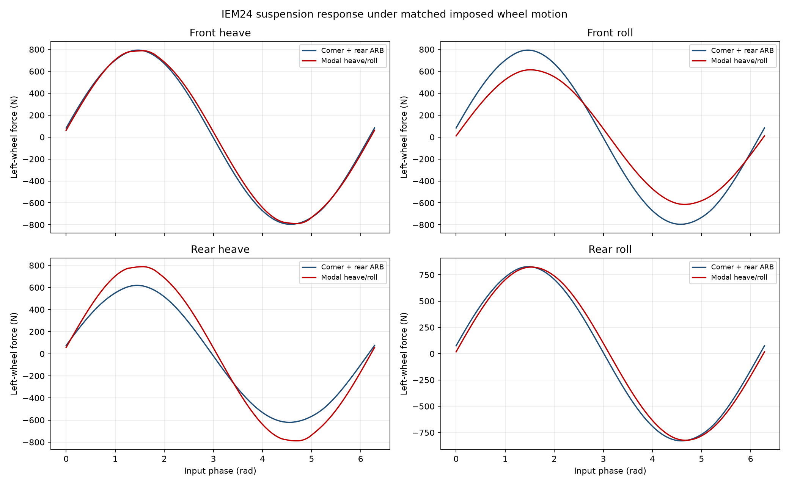
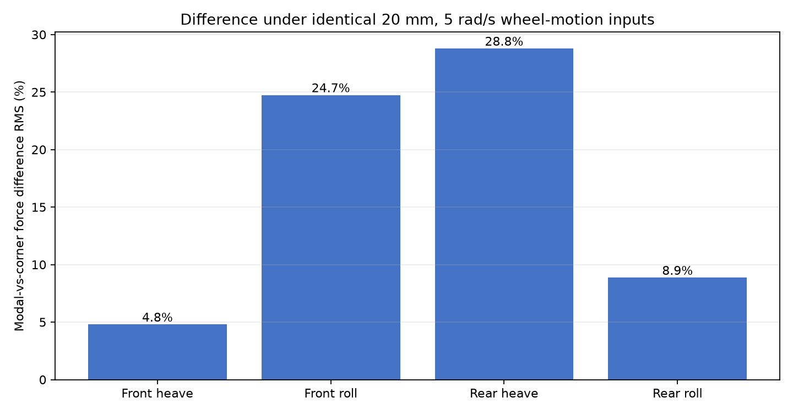

# IEM24 modal roll/heave vs independent-corner + rear ARB suspension comparison

**Exploratory model-to-model suspension response report. This is not a simulated lap, measured-vehicle validation, or acceptance result.** It intentionally does not follow the MIS lap-report format because no lap or telemetry comparison was requested.

## Configuration

- Baseline model A: independent-corner suspension with the existing rear ARB.
- Baseline model B: axle modal heave/roll suspension, separate heave/roll damper tables and click settings from real car data.
- Spring rates: 450 lbf/in heave at both axles; 350 lbf/in front roll; 350 lbf/in rear roll plus 120 lbf/in equivalent rear ARB contribution.
- Damper clicks in modal model: heave 6 front/rear; roll 5 front and 8 rear. Corner baseline retains its own configured click values.
- Each test applies one 20 mm peak sinusoidal jounce mode at angular frequency 5 rad/s (velocity peak 0.1 m/s); both networks receive identical wheel displacement and velocity vectors.
- Plotted traces and peak-force metrics show dynamic force relative to each model's zero-input baseline; difference metrics use both wheels on the excited axle.

## Method

Front/rear heave inputs move both axle wheels equally; roll inputs move the two wheels equally and oppositely. Matched corner motions avoid interpreting the model's distinct internal coordinate conventions as different physical inputs. The roll/heave modes are examined separately; body dynamics, tires, road inputs, and vehicle trajectories are not simulated.

## Force comparison

| Input | Corner peak force (N) | Modal peak force (N) | Difference peak (N) | Difference RMS (N) | Difference RMS (%) |
|---|---:|---:|---:|---:|---:|
| Front heave | 795.4 | 788.1 | 54.7 | 26.9 | 4.8% |
| Front roll | 795.4 | 614.0 | 200.6 | 138.9 | 24.7% |
| Rear heave | 620.8 | 788.1 | 182.6 | 126.1 | 28.8% |
| Rear roll | 828.9 | 823.7 | 90.7 | 51.8 | 8.9% |





## Linearized comparison

Central-difference force Jacobians at zero jounce and zero velocity (including damper branch slope) are recorded in `comparison_summary.json`.

| Model | Stiffness eigenvalues (N/m) | Damping eigenvalues (N·s/m) |
|---|---|---|
| Corner + rear ARB | 61294, 78807, 78807, 82310 | 1848, 1848, 2029, 2029 |
| Modal heave/roll | 61294, 78807, 78807, 82310 | 48, 53, 643, 750 |

## Reading the comparison

The table reports direct force differences under the same prescribed wheel motion; it does not show which model better matches the car. Spring-rate equivalence does not make the models identical: the modal layout uses modal springs and dedicated mode damper tables/settings, while the corner model uses corner spring curves, corner dampers and the independent ARB force path. Differences therefore reflect both the force-law structure and the distinct damper data/settings.

## Caveats

- The independent-corner model's local spring behavior is the committed corner LUT; modal spring behavior uses scalar modal rates.
- The modal damper table measurements are from real car data, but modal shaft motion is mapped using declared heave/roll motion ratios and the modal Jacobian.
- Corner baseline uses configured corner damper settings; it is not retuned here to match the modal click settings.
- This is a deterministic imposed-motion comparison only. No unsprung/body integration, road excitation, lap, or measured response data is included.
- These are the values we did not measure: this report makes no claim that either response is validated against measured suspension forces or damper dyno output.

## Reproduce

```bash
PYTHONPATH=src:. MPLCONFIGDIR=/tmp/matplotlib-config python3 tools/reports/compare_iem24_modal_vs_corner.py --output-dir docs/validation/iem24-murphy/modal_vs_corner_arb
```

Generating tool: `tools/reports/compare_iem24_modal_vs_corner.py`. Modal damper tables are generated from real car data by `tools/model_data/import_real_mode_dampers.py`.
