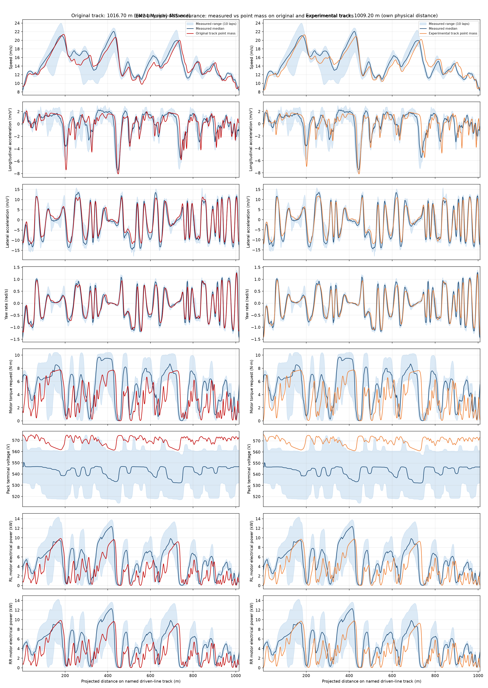
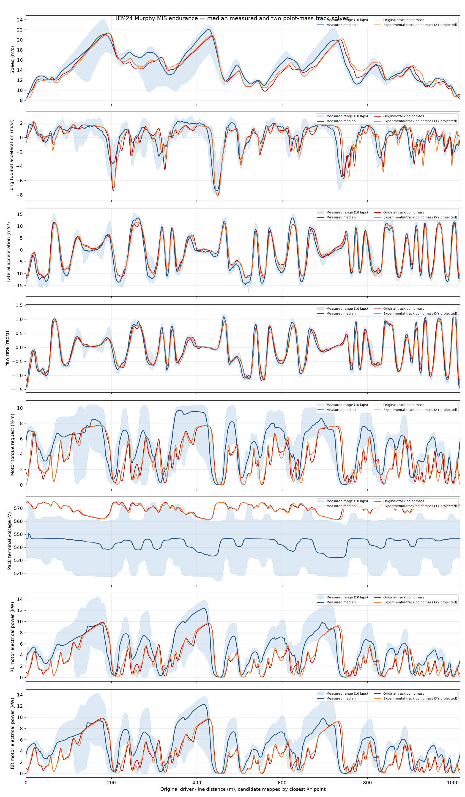
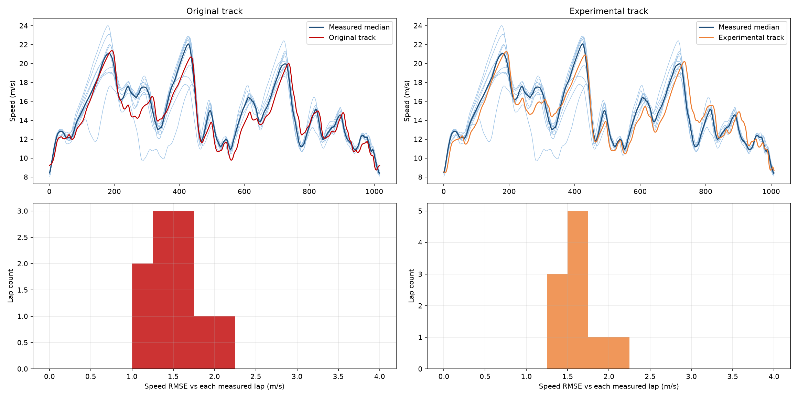
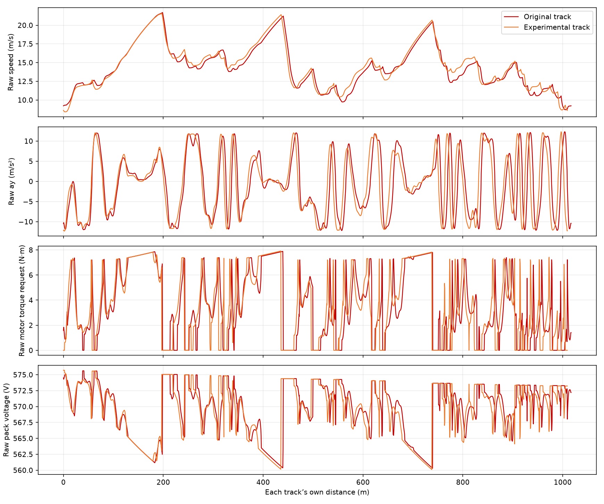

# IEM24 Murphy simulated MIS 2024 laps vs measured endurance stint — original and experimental tracks

> **Superseded 2026-10-16:** generated with track 1.016 m and 55 % front mass. Values do not apply to the current vehicle.
>
> The Configuration below records the geometry that was simulated (CGx 45 % of wheelbase from the front axle, 55 % of the mass at the front). The current vehicle has CG 55 % behind the front axle. The data and figures are unchanged.

## Configuration

- Both runs: identical 287 kg car-and-driver mass (209 kg car + 78 kg driver); LLTD 42%, CGx 45% of wheelbase from the front axle (55% mass at front), CG height 0.300 m, 65% front mechanical brake bias.
- Aero: air density 1.22 kg/m³, CL·A 3.5 m², CD·A 1.55 m², front aero balance 50%.
- Drivetrain: two rear motors, 10.5 N·m per-motor limit, 10.9:1 motor gear ratio and 95% transmission efficiency; regeneration disabled. Reduced point-mass UniTire pure-slip peak envelope with the same compiled IEM24 planar vehicle parameters in both solves.
- Initial conditions: flying closed-lap speed solved periodically; battery SOC 0.829085 (resting pack 575.70 V measured before launch), terminal voltage at first reported segment 574.49 V in both runs; no measured tire temperature or ambient state initialized.
- Original path: `models/tracks/2024_michigan_endurance_closed.xml`, length 1016.701 m, 2035 nodes, flying lap 73.591 s. Experimental median driven line: `docs/validation/iem24-murphy/multilap_track_candidate.xml`, length 1009.195 m, 2020 nodes, flying lap 71.958 s. Mesh target 0.5 m in both.
- Solver: energy-coupled minimum-time *point-mass* forward/backward lap, no planar 7DoF. Original convergence: True in 3 profile iterations and 2 energy iterations; experimental: True in 3 and 3 respectively. Converged prescribed-path minimum-time model, **not** a measured validated lap or a joint optimized racing line.

## Measured data

Source `~/Desktop/0615CompEndurance.mat`, SHA-256 `091e4745a5ff6ccf7d48729154033bb555edd028f0e3e2ed2f3f270e14f6e5b7`, 334513192 bytes; shared log clock approximately 100 Hz, position/navigation fixes less frequent. Conditioning uses 105.00–938.00 s for lap identification, driving window 117.02–925.91 s. Navigation `VNorth`, `VEast`, `VelX`, `VelY`, `AccelX`, `AccelY`, `GyroZ`; per-motor requests `Tq_RL_Req`, `Tq_RR_Req`; pack voltage `VPack`; electrical power `pwrRLReal`, `pwrRRReal`. Existing `measured_stint.csv` is unchanged. The 8.55° navigation-unit yaw skew rotates VelX/VelY and AccelX/AccelY into the body frame; corrected acceleration/velocity-rate RMSE is 0.322 instead of 1.362 m/s². Navigation accelerations, speed and torque/voltage were preconditioned with a zero-phase first-order low-pass filter at 1 Hz; measured power channels are separately filtered the same way. The two model traces are independently low-pass filtered with first-order 1 Hz zero-phase filtering in **time** for their scored overlays; raw model exports are preserved. No voltage zeroing, no inferred time shift and no equal-length scaling were applied.

| Lap | Start (s) | Lap time (s) | Driven distance (m) | Mean speed (m/s) | Closure radius (m) |
|---|---:|---:|---:|---:|---:|
| 0 (standing start) | 105.00 | 85.36 | 1026.7 | 12.03 | 7.21 |
| 1 (flying) | 190.36 | 77.31 | 1020.9 | 13.20 | 0.86 |
| 2 (flying) | 267.67 | 72.58 | 1023.2 | 14.10 | 0.71 |
| 3 (flying) | 340.25 | 73.71 | 1021.6 | 13.86 | 0.18 |
| 4 (flying) | 413.96 | 71.24 | 1020.1 | 14.32 | 0.02 |
| 5 (flying) | 485.20 | 70.01 | 1021.2 | 14.59 | 0.62 |
| 6 (flying) | 555.21 | 74.23 | 1023.0 | 13.78 | 1.60 |
| 7 (flying) | 629.44 | 69.99 | 1023.2 | 14.62 | 0.88 |
| 8 (flying) | 699.43 | 70.92 | 1023.4 | 14.43 | 0.72 |
| 9 (flying) | 770.35 | 72.13 | 1023.2 | 14.19 | 1.13 |
| 10 (flying) | 842.48 | 70.57 | 1021.8 | 14.48 | 0.64 |

Median of 10 flying laps: **71.685 s** over **1022.40 m**; measured driven distance exceeds original geometry by +0.56% and experimental geometry by +1.31%. Each measured position is projected independently onto each track after fitting a constant north/east translation; then each lap is interpolated on **that track's own physical distance** and the median and full range are computed anew. The two columns in `comparison.png` are **not pointwise aligned to each other**: their lengths differ by 7.51 m. Position residual p95 is 2.45 m old, 2.28 m experimental. This design avoids assuming a normalized phase is a physical distance.

## Trace comparison

Each model is compared to the median of the **same 10 flying laps**, reprojected onto its named track. Measured range shading uses the minimum and maximum individual lap values, never the standing-start lap. The six required channels below are scored on 1017 track-distance grid points. Bias is signed **sim − meas**, in the row's unit. Supplementary RL/RR power panels follow the standard channels; their full exploratory statistics are in `comparison_summary.json`, but their sensor/bus accounting is insufficient to interpret as motor-power validation. RL/RR model electrical powers are equal halves of the point-mass energy solver's total bus power; measured RL/RR are separately logged motor electrical-power channels, whose measurement location may differ from bus power.

| Signal | Track | RMSE | MAE | Bias (sim − meas) | Correlation | Normalised RMSE |
|---|---|---:|---:|---:|---:|---:|
| Speed (m/s) | Original track | 1.154 | 0.955 | -0.513 | 0.940 | 0.380 |
| Speed (m/s) | Experimental track | 1.259 | 1.058 | -0.321 | 0.917 | 0.416 |
| Longitudinal acceleration (m/s²) | Original track | 1.141 | 0.791 | -0.104 | 0.804 | 0.633 |
| Longitudinal acceleration (m/s²) | Experimental track | 1.234 | 0.852 | -0.107 | 0.773 | 0.682 |
| Lateral acceleration (m/s²) | Original track | 2.108 | 1.683 | +0.822 | 0.971 | 0.277 |
| Lateral acceleration (m/s²) | Experimental track | 2.307 | 1.871 | +0.762 | 0.963 | 0.304 |
| Yaw rate (rad/s) | Original track | 0.146 | 0.108 | +0.003 | 0.970 | 0.250 |
| Yaw rate (rad/s) | Experimental track | 0.174 | 0.128 | -0.000 | 0.957 | 0.298 |
| Motor torque request (N·m) | Original track | 2.738 | 2.253 | -1.537 | 0.602 | 1.030 |
| Motor torque request (N·m) | Experimental track | 2.743 | 2.240 | -1.464 | 0.586 | 1.030 |
| Pack terminal voltage (V) | Original track | 27.001 | 26.737 | +26.737 | 0.568 | 6.230 |
| Pack terminal voltage (V) | Experimental track | 26.877 | 26.611 | +26.611 | 0.571 | 6.197 |



The requested single-axis overlay maps the experimental track's model nodes to the nearest original-track XY nodes; it retains both independent solved traces rather than stretching either lap to the other's length. Its distances are approximate XY correspondence, not an equal-distance comparison metric.







## Reading the comparison

- **1.633 s**: experimental-track model is faster than original (71.958 vs 73.591 s). Differences mix altered path curvature and a 7.51 m shorter path; they are not a measured handling improvement. The old run is +1.906 s and the new run +0.273 s from the measured median flying lap.
- **Speed:** RMSE 1.154 → 1.259 m/s, correlation 0.940 → 0.917; both runs use the same powertrain but different curvature/length constraints.
- **Longitudinal acceleration:** RMSE 1.141 → 1.234 m/s². Repeated braking impulses can survive common filtering: a quasi-static minimum-time planner need not brake as a human driver does.
- **Lateral acceleration:** RMSE 2.108 → 2.307 m/s², correlation 0.971 → 0.963. At about 252–268 m on the original line, two stored curvature maxima create two point-mass ay maxima; the experimental ten-lap smoothed line has one broader apex. Exact horizontal coordinates differ on the shorter line.
- **Yaw rate:** RMSE 0.146 → 0.174 rad/s. Measured ay contains an approximately −0.7 m/s² bias relative to v·yaw, so yaw and ay changes must not be interpreted as pure geometry agreement.
- **Motor torque request:** RMSE 2.738 → 2.743 N·m. Positive simulated request is reconstructed from the model's rear-wheel drive force and 95% gear efficiency; friction braking has zero motor request and regen is disabled.
- **Pack terminal voltage:** bias +26.74 → +26.61 V. Both model laps start at stint-start SOC while measured flying laps span a discharging stint, so the voltage bias is predominantly an **initial-condition offset**, not evidence that either geometry predicts battery voltage better.
- **RL and RR motor electrical power (exploratory):** RL RMSE 2.801 → 2.797 kW; RR RMSE 2.756 → 2.755 kW. These statistics are *not directly comparable component errors*: point mass allocates equal halves of pack bus power and logged left/right motor-power accounting is unverified. They are shown for trace context only. No independent wheel torques were solved.
- **Spread:** original speed RMSE vs each flying lap spans 1.120–2.015 m/s; experimental spans 1.279–2.211 m/s. These are against each geometry's reprojection, not against identical coordinates.

## Caveats

- **These are the values we did not measure** for this car in the log: wheelbase, track width, tire force envelope, battery resistance/capacity map, drivetrain efficiency, ambient air density, and mechanical brake bias; they are carried over from the IEM24 vehicle compilation, not inferred from this paired-track experiment. The 10.5 N·m motor torque cap is a model calibration; logged requests peak near 10.45 N·m.
- The old 'centreline' is one integrated driven lap, not surveyed centreline; the experimental line is a median of all ten flying laps and shares those same laps with validation. It shrinks 7.5 m after XY smoothing. This is circular calibration and cannot establish the experimental geometry as ground truth. The original source window has a 3.45 m closure gap and tangent mismatch near the seam.
- `pwrRLReal`/`pwrRRReal` sensor definition and bus-power allocation may differ: compare the motor-power shape cautiously, not as a component-efficiency validation. Model power represents equal halves of total bus draw; measured power may include different inverter/motor accounting.
- Terminal voltages differ because SOC starts at 0.829085 in both models, before the actual measured flying stint. Initial model terminal voltage is reported at the first segment (the battery is at 575.70 V resting); no flight-lap SOC is matched. No log tire state or ambient temperature was used.
- Model ay and yaw are prescribed-track kinematics; point mass cannot represent steering, vehicle yaw transients, sideslip or differing driver lines. Segment acceleration and yaw are held at the last segment to plot the closing node; a distance-grid comparison is not proof of dynamic tracking. Figure columns must not be read as sharing identical physical XY locations.

## Reproduce

```bash
# Run from the repository root with Python, SciPy, NumPy and matplotlib installed.
# The source MAT must be available at ~/Desktop/0615CompEndurance.mat.
PYTHONPATH=src:. python3 tools/tracks/build_iem24_multilap_track.py
PYTHONPATH=src:/tmp/casadi_pkgs python3 tools/run/run_iem24_point_mass_track_pair.py
PYTHONPATH=src:. MPLCONFIGDIR=/tmp/matplotlib-config python3 tools/reports/report_iem24_point_mass_track_pair.py
```

Report generator: `tools/reports/report_iem24_point_mass_track_pair.py`, paired solver: `tools/run/run_iem24_point_mass_track_pair.py`; follows the [MIS 2024 report standard](../../../standards/mis-2024-report-standard.md). The measured input files `measured_stint.csv` and `telemetry_extraction.json` were produced by `tools/data/extract_iem24_telemetry.py` and are not rewritten here.
