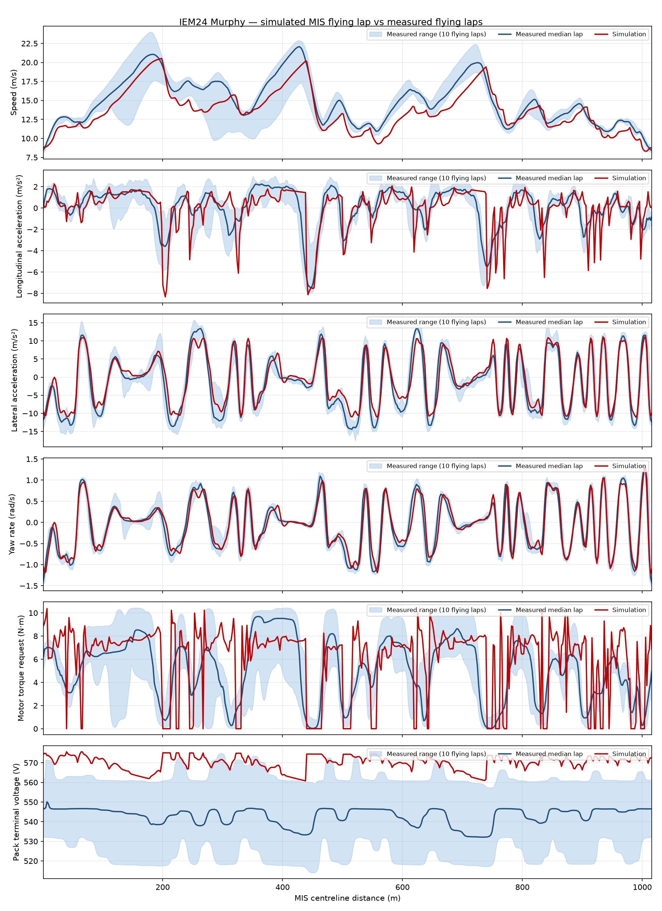
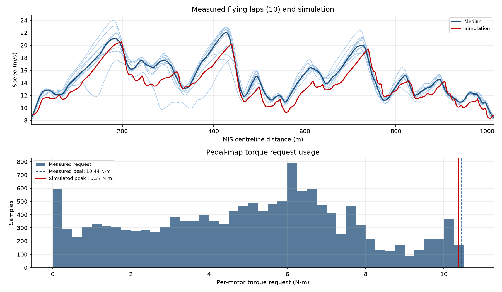
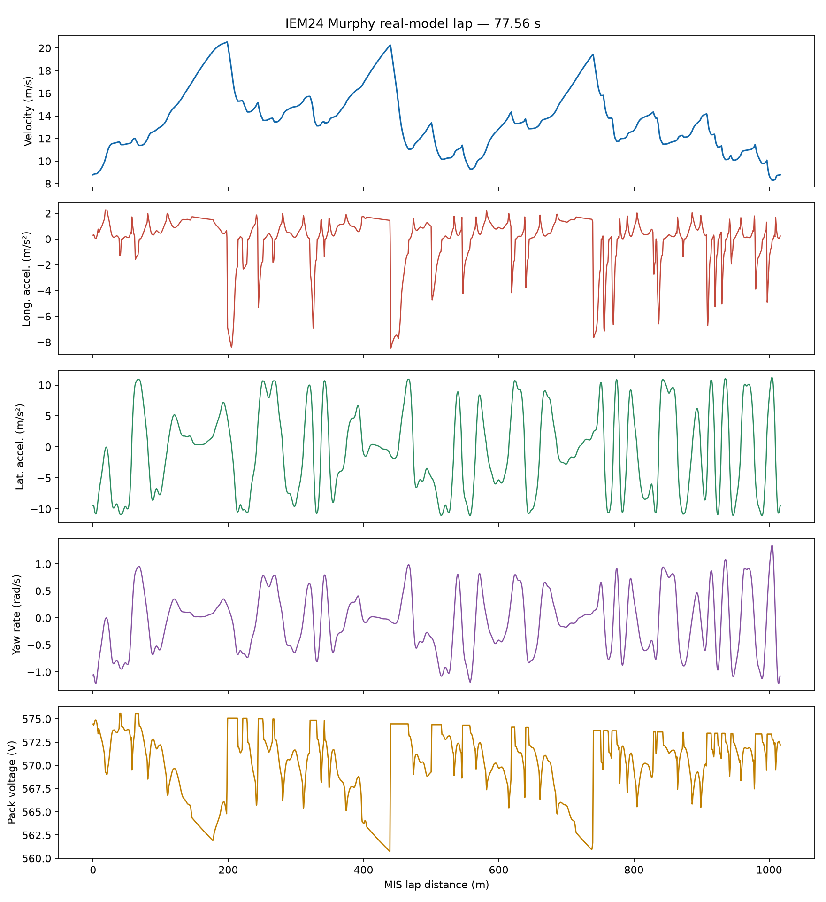

# IEM24 Murphy: simulated MIS lap vs measured endurance stint

## Configuration

- Vehicle: 287 kg (209 kg car + 78 kg driver), LLTD 42 %, CGx 45 % of wheelbase
  from the front axle, CG height 0.300 m.
- Aero: CL·A = 3.5 m², CD·A = 1.55 m², aero balance 50 %.
- Drivetrain: two rear motors only, APPS 0–100 % requests 0–10.5 N·m
  per motor, regeneration disabled, mechanical brakes only.
- Simulated flying lap: 77.561 s over
  1016.701 m on the signed closed MIS centreline.
- Pack initial bus voltage: 575.70 V compiled from the
  measured resting voltage at the start of the stint; the simulated terminal voltage
  at the first node is 574.31 V.

## Measured data

The stint runs from 117.02 s to
925.91 s on the log clock; the car is
stationary before and after. Laps are segmented by navigation-unit position closure,
which needs no start/finish instrumentation: the car returns to the previous lap
boundary once per lap, and every closure was within
7.21 m.

| Lap | Start (s) | Lap time (s) | Driven distance (m) | Mean speed (m/s) | Closure radius (m) |
|---|---:|---:|---:|---:|---:|
| 1 | 190.36 | 77.31 | 1020.9 | 13.20 | 0.86 |
| 2 | 267.67 | 72.58 | 1023.2 | 14.10 | 0.71 |
| 3 | 340.25 | 73.71 | 1021.6 | 13.86 | 0.18 |
| 4 | 413.96 | 71.24 | 1020.1 | 14.32 | 0.02 |
| 5 | 485.20 | 70.01 | 1021.2 | 14.59 | 0.62 |
| 6 | 555.21 | 74.23 | 1023.0 | 13.78 | 1.60 |
| 7 | 629.44 | 69.99 | 1023.2 | 14.62 | 0.88 |
| 8 | 699.43 | 70.92 | 1023.4 | 14.43 | 0.72 |
| 9 | 770.35 | 72.13 | 1023.2 | 14.19 | 1.13 |
| 10 | 842.48 | 70.57 | 1021.8 | 14.48 | 0.64 |

The lap that begins at the start of the window is a standing start and is excluded
from the flying-lap comparison. Median measured flying lap:
71.69 s over 1022.2 m
driven, which is +0.54 %
longer than the 1016.7 m centreline.

### Putting measured and simulated laps on one axis

Every measured sample is projected onto the signed closed MIS centreline, so both
traces share one physical lap-distance axis and no phase alignment has to be
inferred. The logged position is a dead-reckoned integral of the logged velocity,
so a constant translation is fitted first (+9.97 m north,
+3.43 m east). After the fit the measured path sits a median of
0.98 m from the centreline (95th percentile
2.45 m), which is the driven line's normal offset.

### Navigation-unit skew

The unit is mounted at a yaw skew of **8.55°**
(interquartile spread 0.30°,
estimated from 6,752 straight high-speed samples).
The skew is material: rotating the horizontal channels into the body frame raises the
agreement between the longitudinal accelerometer and the differentiated longitudinal
velocity from 0.816 to
0.984
(RMSE 1.362 → 0.322 m/s²).
The corrected lateral channel then matches the centripetal acceleration with
correlation 0.994
and slope 0.992.

All measured channels are low-pass filtered at 1 Hz with a zero-phase first-order
filter so that they can be compared with a quasi-static lap simulation.

### Pack voltage initial condition

The model's initial bus voltage is set from the logged `VPack` channel. While the car
is parked for the 12 s before launch the pack rests at
**575.70 V** (standard deviation
0.048 V over 1,202
samples), and that is the value compiled into
`models/energy-storages/iem24_murphy_real_battery.xml`, which resolves to an initial
state of charge of 0.8291.

The simulated trace is the pack **terminal** voltage, `V_oc − I·R`, because the logged
channel is a terminal measurement rather than an open-circuit estimate. It runs from
574.3 V down to 560.8 V
across the lap.

One caveat applies when reading the voltage panel: the model lap starts from the
stint-start voltage, while the ten measured flying laps start from a median of
550.65 V (from
575.6 V on the first flying lap down to
532.3 V on the last) because the pack discharges
through the stint. The simulated voltage therefore sits about
27.2 V above the measured flying-lap median, which is
an initial-condition offset rather than a model error. The pack itself behaves
plausibly on both sides: under way the measured pack sits at a median of
546.5 V and sags to 513.9 V
at its lowest, which is the expected terminal droop under drive current.

The choice of initial voltage moves the voltage trace but barely moves the lap: over
530–600 V the simulated lap time varies by only 0.19 % (77.41–77.56 s), because the
two-motor rear drive is torque-limited rather than voltage-limited across this speed
range. Setting `initial_bus_voltage` to
550.65 V in
`models/energy-storages/iem24_murphy_real_battery.xml` instead would centre the
voltage trace on the flying laps.

## Trace comparison

The measured traces are folded onto the centreline distance grid and reduced to the
median across the 10 flying laps.

| Signal | RMSE | MAE | Bias (sim − meas) | Correlation | Normalised RMSE |
|---|---:|---:|---:|---:|---:|
| Speed (m/s) | 1.659 | 1.438 | -1.260 | 0.935 | 0.547 |
| Longitudinal acceleration (m/s²) | 1.529 | 1.012 | -0.112 | 0.680 | 0.847 |
| Lateral acceleration (m/s²) | 2.438 | 1.906 | +0.890 | 0.957 | 0.321 |
| Yaw rate (rad/s) | 0.165 | 0.119 | +0.006 | 0.960 | 0.281 |
| Motor torque request (N·m) | 3.010 | 2.251 | +0.914 | 0.497 | 1.132 |
| Pack terminal voltage (V) | 27.473 | 27.199 | +27.199 | 0.540 | 6.345 |





### Simulated lap in isolation

The simulated lap on its own, including the pack-voltage channel that carries the
initial condition, comes from the lap generator:



## Reading the comparison

- The simulated lap is **5.88 s slower**
  than the measured median flying lap (77.56 s against
  71.69 s), and 7.57 s
  slower than the fastest measured lap.
- The speed trace tracks the measured shape closely (correlation
  0.935) but sits
  1.26 m/s low on average. The measured median peaks at
  22.1 m/s against
  20.5 m/s simulated, so the deficit is a
  top-speed and corner-exit problem rather than a general offset.
- Lateral acceleration is the strongest grip signal
  (correlation 0.957). The measured median reaches
  14.4 m/s² against
  11.1 m/s² simulated, so the model
  corners slightly below the real car and that is where the lap time goes.
- Yaw rate agrees almost exactly (bias +0.006 rad/s,
  correlation 0.960), which confirms that the simulated
  lap geometry matches the driven line.
- Longitudinal acceleration lines up on every braking event, but the model switches
  between traction and braking instantly while the real traces ramp; that difference
  dominates the 1.53 m/s² RMSE.
- The torque request trace is the weakest match
  (correlation 0.497). The real driver modulates the
  pedal continuously, while the point-mass simulated lap holds the 10.5 N·m limit on the
  straights, so the sim runs a higher mean request
  (bias +0.91 N·m) for the same or lower speed.
- Per-lap speed RMSE across the ten flying laps ranges from
  1.47 to 2.22 m/s
  (median 1.83 m/s), so the simulation sits inside the
  lap-to-lap spread of the stint rather than matching one particular lap.
- The pack terminal voltage droops with drive current and recovers off the pedal on
  both sides, but the traces only partly correlate
  (0.540) and the simulated one sits
  27.2 V high because the model lap starts from the
  stint-start voltage rather than a mid-stint voltage; see the initial-condition note
  above.

## Caveats

- Wheelbase, track width, tire model, battery, gear ratio, air density and mechanical
  brake bias are carried over from the existing Murphy model rather than re-measured
  at IEM24.
- The logged `Tq_*_Req` channels resolve to 0.01 N·m and peak at 10.45 N·m, which is
  0.5 % below the 10.5 N·m value the model uses.
- The measured position is integrated from the logged velocity, not a position
  solution, so the centreline residuals include any integration drift.

## Reproduce

```bash
# 1. Run one simulated flying lap and write simulated_lap.csv.
PYTHONPATH=src:/tmp/casadi_pkgs MPLCONFIGDIR=/tmp/matplotlib-config \
  python3 tools/run_iem24_murphy_lap.py --output-dir docs/validation/iem24-murphy

# 2. Condition the logged stint: skew correction, lap segmentation, 1 Hz low-pass.
PYTHONPATH=src:/tmp/casadi_pkgs \
  python3 tools/data/extract_iem24_telemetry.py --output-dir docs/validation/iem24-murphy

# 3. Project the measured path onto the centreline and write this report.
PYTHONPATH=src:/tmp/casadi_pkgs MPLCONFIGDIR=/tmp/matplotlib-config \
  python3 tools/reports/compare_iem24_murphy_stint.py --output-dir docs/validation/iem24-murphy
```

This report is generated by `tools/reports/compare_iem24_murphy_stint.py` and follows the
[MIS 2024 report standard](../../standards/mis-2024-report-standard.md).
