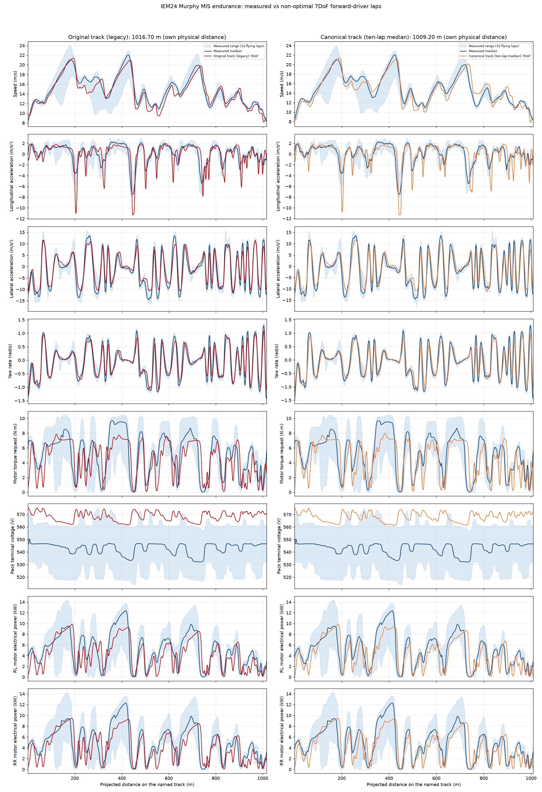
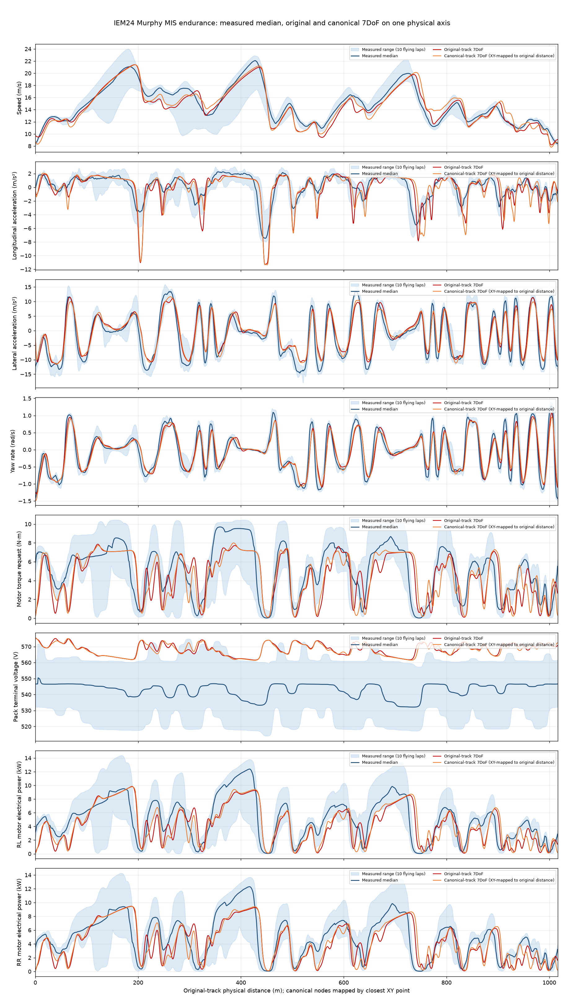
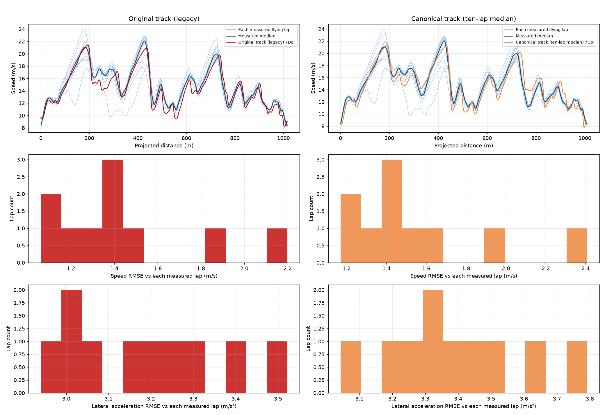
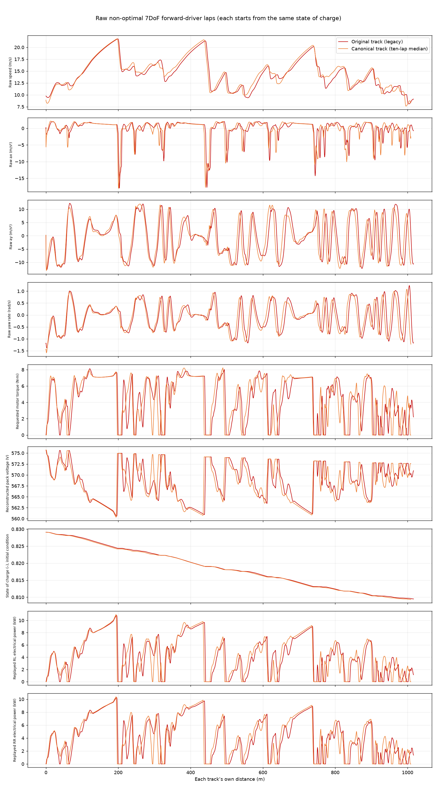

# IEM24 Murphy simulated MIS 2024 laps (7DoF forward driver) vs measured endurance stint — legacy original and canonical tracks

Michigan International Speedway 2024 endurance circuit, the IEM24 Murphy car, **simulated 7DoF laps compared with the measured endurance stint**. This report follows the [MIS 2024 report standard](../../../standards/mis-2024-report-standard.md) without departure. At least one attempt fails an acceptance gate (table in Configuration): these are **driven, non-optimal transient 7DoF laps and are not validated results**. No claim of validation is made.

## Configuration

- Mass: 287 kg (209 kg car + 78 kg driver), identical in both runs. Yaw radius of gyration 0.679366 m, wheel inertia 0.2065 kg·m² per wheel.
- Chassis: wheelbase 1.535 m, track 1.016 m, LLTD 42 %, CGx 55 % of the mass on the front axle (CG 0.6907 m behind the front axle), CG height 0.3 m, 65 % front mechanical brake bias.
- Aero: air density 1.22 kg/m³, CL·A = 3.5 m², CD·A = 1.55 m², aero balance 50 %.
- Drivetrain: 2 rear motors, 10.5 N·m per-motor torque cap (`apps_fraction` 1 requests 10.5 N·m), 20 kW per motor, 10.9:1 gear ratio, regeneration off. Tire: UniTire (`models/tires/iem24_murphy_real_unitire.xml`) with wheel-speed states and combined slip. Road friction values used (compiled from the tire file, identical in both runs): μ₀ₓ = 1.557442, μₛₓ = 1.343961, μ₀ᵧ = 1.586920, μₛᵧ = 1.369043 (peak and sliding, longitudinal and lateral; slip stiffness unchanged from the lab fit). Tire-file note (verbatim from the XML comment): "PROPOSED road-grip baseline, not a measured or validated road coefficient. mu_0_x, mu_s_x, mu_0_y and mu_s_y are each exactly 2/3 of that lab fit (2.3361624600071096, 2.0159412226800204, 2.3803804777987394, 2.053563821658717). The 2/3 factor is a TTC Round 9 team-reported road prior (belt smoother than track; https://www.millikenresearch.com/Contents_Round9.pdf), not inferred from the 120-grit belt label and not validated by the vehicle." Evidence and identifiability: [road grip calibration](../road_grip_calibration.md).
- Battery: 144s1p, 200 A discharge limit, SOC-dependent OCV and resistance from the cell curves.
- Driver and solver (identical for both attempts): planner `live`, maximum speed 60 m/s, lateral-acceleration cap planner default (none beyond the vehicle limits for `live`), pedal travel time 0.175 s, BDF with rtol 1e-05, maximum step 0.02 s, path spacing 0.5 m. Transient forward driver: **not a minimum-time optimum** (`minimum_time_optimum` = false in both summaries); the lap is a completed exploratory trajectory, and its feasibility or validity is **not** established unless every acceptance gate below passes.
- Initial conditions: first accepted state is v_x 9.695 m/s (original) and 8.810 m/s (canonical), battery SOC 0.829085 (the model's initial SOC, set from the resting pack voltage of 575.70 V measured before launch), initial road-wheel angle -0.1860 / -0.2482 rad aligned with the path curvature. No measured tire temperature or ambient state initialises either run.
- Simulated lap: original **73.563 s** over 1016.701 m on `models/tracks/2024_michigan_endurance_closed.xml` (legacy single-lap integrated line, retained unchanged); canonical **71.907 s** over 1009.195 m on `models/tracks/2024_michigan_endurance_multilap_closed.xml` (median of ten flying laps, smoothed; the repository's canonical MIS line). Attempts: `docs/validation/iem24-murphy/seven_dof_track_pair/original/attempt_1792091044461992000` and `docs/validation/iem24-murphy/seven_dof_track_pair/new/attempt_1792091049300790000`.
- Solver status: both attempts record status Completed with a full lap, accepted steps 11964 / 12029, maximum lateral path error 0.233 / 0.212 m, final SOC 0.809487 / 0.809328. Periodic closure is the largest ratio of end-minus-start state difference to its tolerance: 368.9× (original), 418.1× (canonical).

Acceptance gates recorded in each attempt's `summary.json`:

| Gate | Original track | Canonical track |
|---|---|---|
| Full lap completed | PASS | PASS |
| Integration completed | PASS | PASS |
| Periodic closure (end state = start state) | FAIL | FAIL |
| Path tracking (lateral error ≤ 0.25 m) | PASS | PASS |
| Accepted spatial step resolution | PASS | PASS |
| Physics checked at every accepted state | PASS | PASS |
| Between-step validation | FAIL | FAIL |
| Refinement validated | FAIL | FAIL |
| Tire contact loads non-negative | PASS | PASS |
| **Recorded `usable` verdict** | **FAIL** | **FAIL** |

Model inputs hashed by the attempts (SHA-256; re-verified against the files on disk and against each attempt's `source_snapshot` before this report was written; the vehicle, tire and formulation entries are identical in both attempts):

| Input | Path | SHA-256 |
|---|---|---|
| track_xml (original) | `models/tracks/2024_michigan_endurance_closed.xml` | `2880418d148b763e1360d25eb4b7a8a4144bb16e6e56017facf7f36bddc47180` |
| track_xml (canonical) | `models/tracks/2024_michigan_endurance_multilap_closed.xml` | `ffc367c0286ba698f3706ae8baf34946c641c01ad4f71935d3ec14a3a326f2c3` |
| track_csv (original) | `models/tracks/2024_michigan_endurance_closed.csv` | `ff8dcdc715eaff07eeb1d7a9e0a0739072480150577622ec8854000a0a44dbd4` |
| track_csv (canonical) | `models/tracks/2024_michigan_endurance_multilap_closed.csv` | `2db5a981f12d0c055afa3b167a9e6efa07cd09b1f6e7b2c51afea44f00e73d77` |
| tire_xml (both) | `models/tires/iem24_murphy_real_unitire.xml` | `301c55c8213fd9a4149bdec39a8c6fbc6a756e750bd6bd92e80b6567bcbd917b` |
| formulation_xml (both) | `models/formulations/iem24_murphy_real_planar_7dof.xml` | `8420c2d4e929f629c52fb9a21e1b1e5d047bf2356615d3edfc0a8e95bf6878d8` |
| vehicle_xml (both) | `models/vehicles/iem24_murphy_real_planar.xml` | `46d3d342457c2f0fb55b864fc592f54d15b4d94a3dff4d7ba8004f07ca923a2e` |

## Measured data

Source `~/Desktop/0615CompEndurance.mat`, SHA-256 `091e4745a5ff6ccf7d48729154033bb555edd028f0e3e2ed2f3f270e14f6e5b7`, 334513192 bytes; shared log clock 100 Hz (222394 samples), exported measured table at 19.98 Hz. Conditioning uses 105.00–938.00 s for lap identification and a 117.02–925.91 s driving window. Channels consumed: Navigation `VNorth`, `VEast`, `VelX`, `VelY`, `AccelX`, `AccelY`, `GyroZ`; per-motor requests `Tq_RL_Req`, `Tq_RR_Req`; pack voltage `VPack`; electrical power `pwrRLReal`, `pwrRRReal`. Existing `measured_stint.csv` and `telemetry_extraction.json` are read and unchanged.

Corrections applied to the raw channels: the 8.55° navigation-unit yaw skew rotates VelX/VelY and AccelX/AccelY into the body frame (corrected acceleration-vs-velocity-rate RMSE 0.322 m/s²); the motor torque request is the mean of `Tq_RL_Req` and `Tq_RR_Req`; navigation accelerations, speed, torque and voltage are conditioned with a zero-phase first-order low-pass filter at 1 Hz and logged RL/RR power the same way. No voltage zeroing, inferred time shift or equal-length scaling is applied.

| Lap | Start (s) | Lap time (s) | Driven distance (m) | Mean speed (m/s) | Closure radius (m) |
|---|---:|---:|---:|---:|---:|
| 0 (standing start) | 105.00 | 85.36 | 1026.7 | 12.03 | 7.21 |
| 1 (flying) | 190.36 | 77.31 | 1020.9 | 13.20 | 0.86 |
| 2 (flying) | 267.67 | 72.58 | 1023.2 | 14.10 | 0.71 |
| 3 (flying) | 340.25 | 73.71 | 1021.6 | 13.86 | 0.18 |
| 4 (flying) | 413.96 | 71.24 | 1020.1 | 14.32 | 0.02 |
| 5 (flying) | 485.20 | 70.01 | 1021.2 | 14.59 | 0.62 |
| 6 (flying) | 555.21 | 74.23 | 1023.0 | 13.78 | 1.60 |
| 7 (flying) | 629.44 | 69.99 | 1023.2 | 14.62 | 0.88 |
| 8 (flying) | 699.43 | 70.92 | 1023.4 | 14.43 | 0.72 |
| 9 (flying) | 770.35 | 72.13 | 1023.2 | 14.19 | 1.13 |
| 10 (flying) | 842.48 | 70.57 | 1021.8 | 14.48 | 0.64 |

Median of the 10 flying laps: **71.685 s** over **1022.40 m** (14.26 m/s mean); the measured driven distance exceeds the original geometry by +0.56% and the canonical geometry by +1.31%. The standing-start lap is in the table and excluded from all statistics.

Alignment: each measured position is projected independently onto each track after fitting a constant north/east translation (original: fit RMSE 1.49 m, residual p95 2.45 m; canonical: 1.47 m, p95 2.28 m); every flying lap is then interpolated onto **that track's own physical distance** and the median and full range are recomputed. The two 7DoF traces are likewise on their own track distance, taken from the integrated path coordinate `s`. The tracks differ in length by 7.51 m, so `comparison.png` keeps **two separate panel columns** (one per track) and nothing is phase-stretched. `three_overlay.png` additionally puts the measured median and both solves on the *original* track's physical distance, mapping canonical nodes by nearest XY point (median node gap 0.30 m, p95 0.91 m, maximum 1.47 m); that mapping is an XY correspondence, not an equal-distance metric.

7DoF channel sources: speed is the body-frame velocity magnitude of the traced states; longitudinal and lateral acceleration are the exporter's body accelerations including the rotating-frame terms; **yaw rate is the traced `yaw_rate` state** (`trace.csv`, sign convention as the state, positive from the path curvature the model integrates); motor torque request is `apps_fraction` × 10.5 N·m, i.e. the *requested* per-motor drive torque before speed regulation, bus-power limits and gear/motor losses (it is not delivered torque, and friction braking has no motor request); pack terminal voltage is **reconstructed** because the 7DoF trace carries no voltage: bus power = RL + RR replayed electrical power from the export, the current is solved with the library battery model (`solve_current`) at the traced SOC, and the loaded terminal voltage is OCV(SOC) − R(SOC)·I (`terminal_voltage`). Consistency check: the SOC drop implied by integrating that current is 0.019598 vs 0.019598 traced (original, 0.00% difference) and 0.019757 vs 0.019757 (canonical, 0.00%). Model traces are low-pass filtered in physical time with the same first-order zero-phase filter at 1 Hz (on a 100 Hz uniform clock) before scoring; raw traces are in `simulated_lap.png`.

## Trace comparison

Each 7DoF lap is compared with the median of the same 10 flying laps reprojected onto its own named track, on a 1017-point (original) and 1009-point (canonical) physical-distance grid. Measured range shading uses the minimum and maximum individual flying-lap value. Bias is signed **sim − meas**, in the row's unit. Each 7DoF lap is a single non-periodic transient from its own initial state, so the start and end of the lap are not steady-state samples.

| Signal | Track | RMSE | MAE | Bias (sim − meas) | Correlation | Normalised RMSE |
|---|---|---:|---:|---:|---:|---:|
| Speed (m/s) | Original track (legacy) | 1.047 | 0.858 | -0.453 | 0.953 | 0.345 |
| Speed (m/s) | Canonical track (ten-lap median) | 1.149 | 0.943 | -0.224 | 0.934 | 0.379 |
| Longitudinal acceleration (m/s²) | Original track (legacy) | 1.486 | 0.943 | -0.237 | 0.772 | 0.824 |
| Longitudinal acceleration (m/s²) | Canonical track (ten-lap median) | 1.569 | 0.991 | -0.219 | 0.746 | 0.867 |
| Lateral acceleration (m/s²) | Original track (legacy) | 2.610 | 2.047 | +0.804 | 0.953 | 0.343 |
| Lateral acceleration (m/s²) | Canonical track (ten-lap median) | 2.855 | 2.265 | +0.742 | 0.940 | 0.377 |
| Yaw rate (rad/s) | Original track (legacy) | 0.208 | 0.152 | +0.003 | 0.938 | 0.355 |
| Yaw rate (rad/s) | Canonical track (ten-lap median) | 0.241 | 0.175 | -0.002 | 0.914 | 0.414 |
| Motor torque request (N·m) | Original track (legacy) | 2.071 | 1.619 | -0.685 | 0.705 | 0.779 |
| Motor torque request (N·m) | Canonical track (ten-lap median) | 2.034 | 1.556 | -0.625 | 0.714 | 0.763 |
| Pack terminal voltage (V) | Original track (legacy) | 25.635 | 25.290 | +25.290 | 0.460 | 5.915 |
| Pack terminal voltage (V) | Canonical track (ten-lap median) | 25.536 | 25.170 | +25.170 | 0.435 | 5.887 |

Supplementary logged-power rows (exploratory, not part of the six required channels):

| Signal | Track | RMSE | MAE | Bias (sim − meas) | Correlation | Normalised RMSE |
|---|---|---:|---:|---:|---:|---:|
| RL motor electrical power (kW) | Original track (legacy) | 2.176 | 1.702 | -0.781 | 0.765 | 0.707 |
| RL motor electrical power (kW) | Canonical track (ten-lap median) | 2.137 | 1.633 | -0.692 | 0.770 | 0.693 |
| RR motor electrical power (kW) | Original track (legacy) | 2.124 | 1.641 | -0.700 | 0.767 | 0.699 |
| RR motor electrical power (kW) | Canonical track (ten-lap median) | 2.083 | 1.573 | -0.613 | 0.772 | 0.684 |









## Reading the comparison

- **Lap time:** the original-track 7DoF lap takes 73.563 s and the canonical-track lap 71.907 s (1.656 s faster on the canonical line, 7.51 m shorter). Against the measured 71.685 s median flying lap that is +1.878 s and +0.222 s; mean speed 13.82 / 14.03 m/s vs 14.26 m/s measured. Planner `live` derives its speed plan from the vehicle's own point-mass limits (maximum-speed cap 60 m/s), so the lap time depends on the carried-over tire grip and powertrain values, not on a driver model fitted to this driver. The 1.656 s difference between the two tracks mixes path curvature, path length, a different initial state and the unconverged (non-periodic) transient start, and is not a measured handling improvement.
- **Speed:** RMSE 1.047 → 1.149 m/s, bias -0.453 → -0.224 m/s, correlation 0.953 → 0.934 (original → canonical).
- **Longitudinal acceleration:** RMSE 1.486 → 1.569 m/s², correlation 0.772 → 0.746. Peak braking after filtering is -11.3 / -11.3 m/s² simulated against -7.5 m/s² in the measured median (raw simulated minimum -18.0 / -18.0 m/s², original / canonical); the simulated driver brakes harder and later than the measured median.
- **Lateral acceleration:** RMSE 2.610 → 2.855 m/s², bias +0.804 → +0.742 m/s², correlation 0.953 → 0.940. The 7DoF lateral acceleration is the body ay of the integrated state (planned peak 13.66 m/s²); the signed bias is probably dominated by a measured-ay offset (the point-mass pair report found measured ay about −0.7 m/s² off v·yaw), not model structure, so RMSE and correlation are the better agreement measures.
- **Yaw rate:** RMSE 0.208 → 0.241 rad/s, correlation 0.938 → 0.914. Yaw is a traced state; measured ay carries a bias relative to v·yaw, so yaw and ay changes must not be read as pure geometry agreement.
- **Motor torque request:** RMSE 2.071 → 2.034 N·m; mean 4.43 / 4.49 N·m simulated vs 5.11 / 5.12 N·m measured. Simulated request is the pedal fraction scaled to 10.5 N·m; the measured channel is the logged mean RL/RR request.
- **Pack terminal voltage (reconstructed):** RMSE 25.635 → 25.536 V, bias +25.29 → +25.17 V; mean 568.3 / 568.1 V simulated vs 543.0 / 543.0 V measured. Both laps start at the stint-start SOC while the measured flying laps span a discharging stint, so this bias is an **initial-condition offset**, not evidence about either geometry; the voltage is an approximation reconstructed from bus power and SOC, not a logged or plant-replayed voltage.
- **RL and RR motor electrical power (exploratory):** RL RMSE 2.176 → 2.137 kW, RR RMSE 2.124 → 2.083 kW. The 7DoF values are replayed per-wheel shaft powers referred to the bus through gear and motor efficiency; the logged `pwrRLReal`/`pwrRRReal` measurement point is not documented, so this is trace context, not a motor-efficiency validation.
- **Spread:** original speed RMSE against each measured flying lap spans 1.113–2.147 m/s; canonical spans 1.226–2.351 m/s. Those are errors against individual laps (the model is not expected to beat the lap-to-lap spread of a human driver); the two columns are against different reprojections, not identical coordinates.
- **Acceptance:** original usable = FAIL, canonical usable = FAIL. Failing gates (table in Configuration) mean these laps stay exploratory comparisons.

## Caveats

- **These are the values we did not measure** for this car in the log: wheelbase, track width, yaw inertia (radius of gyration), wheel inertia, tire force/slip characteristics, battery resistance/capacity map, drivetrain and motor efficiency, steering geometry, brake parameters, ambient air density and mechanical brake bias. They are carried over from the IEM24 vehicle compilation, not inferred from this experiment. The 10.5 N·m motor torque cap is a model calibration.
- These runs are non-optimal driven transients, not minimum-time solutions, and a failed acceptance gate (see Configuration) means the lap is not a validated result. Solver and model source hashes (other than the track files) are identical for both attempts.
- Pack voltage is reconstructed from replayed bus power and traced SOC with the library battery model (not logged and not replayed through the plant's motor-voltage closure); both laps start at SOC 0.829085 before the measured flying laps, which dominates the voltage bias.
- **Road grip is a proposed prior, not a measurement.** The four friction values in Configuration are exactly 2/3 of the lab-fit values, a team-reported road prior. The lab longitudinal data come from a 43100 R20 tire rather than the 43075 modelled (a cross-tire proxy), the longitudinal ratio is unidentifiable on the current lap, and the lateral 2/3 value is optimistic against the ≈0.60 lab ratio estimated from measured |ay|; lap time and the ax/ay/power rows therefore depend on an unvalidated grip assumption. See [road grip calibration](../road_grip_calibration.md).
- The motor torque request is the requested pedal torque, not delivered torque; speed regulation, power limiting and friction braking are not in it.
- The legacy original line is one integrated driven lap with a 3.45 m closure gap; the canonical line is the median of all ten flying laps and shares those laps with this comparison, so its agreement is circular and cannot establish it as ground truth. Different track lengths are never stretched onto one another.
- `pwrRLReal`/`pwrRRReal` sensor definition may differ from the replayed bus-referred wheel power; compare their shape cautiously.
- Model ay and yaw come from a rigid-body planar model with a prescribed driver, not from a fitted driver line; no tire temperature or ambient state was used.

## Reproduce

```bash
# Run from the repository root. Two fresh 7DoF attempts with identical settings, differing only by --track.
OUT=docs/validation/iem24-murphy/seven_dof_track_pair
PYTHONPATH=src:. python3 tools/run_iem24_forward_driver.py --track models/tracks/2024_michigan_endurance_closed.xml --planner live --maximum-speed 60.0 --pedal-travel-time 0.175 --maximum-step 0.02 --rtol 1e-05 --method BDF --spacing 0.5 --duration 300.0 --timeout-seconds 300.0 --output-root "$OUT/original"
PYTHONPATH=src:. python3 tools/run_iem24_forward_driver.py --track models/tracks/2024_michigan_endurance_multilap_closed.xml --planner live --maximum-speed 60.0 --pedal-travel-time 0.175 --maximum-step 0.02 --rtol 1e-05 --method BDF --spacing 0.5 --duration 300.0 --timeout-seconds 300.0 --output-root "$OUT/new"
# Select the newest attempt of each run (the runner names attempts by timestamp), then export and report.
ORIG=$(ls -dt "$OUT"/original/attempt_* | head -1)
NEW=$(ls -dt "$OUT"/new/attempt_* | head -1)
PYTHONPATH=src:. python3 tools/export_iem24_forward_correlation.py "$ORIG"
PYTHONPATH=src:. python3 tools/export_iem24_forward_correlation.py "$NEW"
PYTHONPATH=src:. MPLCONFIGDIR=/tmp/matplotlib-config python3 tools/report_iem24_seven_dof_track_pair.py \
    --original-attempt "$ORIG" --new-attempt "$NEW"
```

This report was generated from the attempts `docs/validation/iem24-murphy/seven_dof_track_pair/original/attempt_1792091044461992000` and `docs/validation/iem24-murphy/seven_dof_track_pair/new/attempt_1792091049300790000`; a fresh two-run reproduction creates new attempt directories and therefore new timings. To re-render only, pass those two directories to the generator. Report generator: `tools/report_iem24_seven_dof_track_pair.py`; exporter: `tools/export_iem24_forward_correlation.py`; follows the [MIS 2024 report standard](../../../standards/mis-2024-report-standard.md). The measured input files `measured_stint.csv` and `telemetry_extraction.json` were produced by `tools/extract_iem24_telemetry.py` and are not rewritten here; the source MAT must be at `~/Desktop/0615CompEndurance.mat`.
