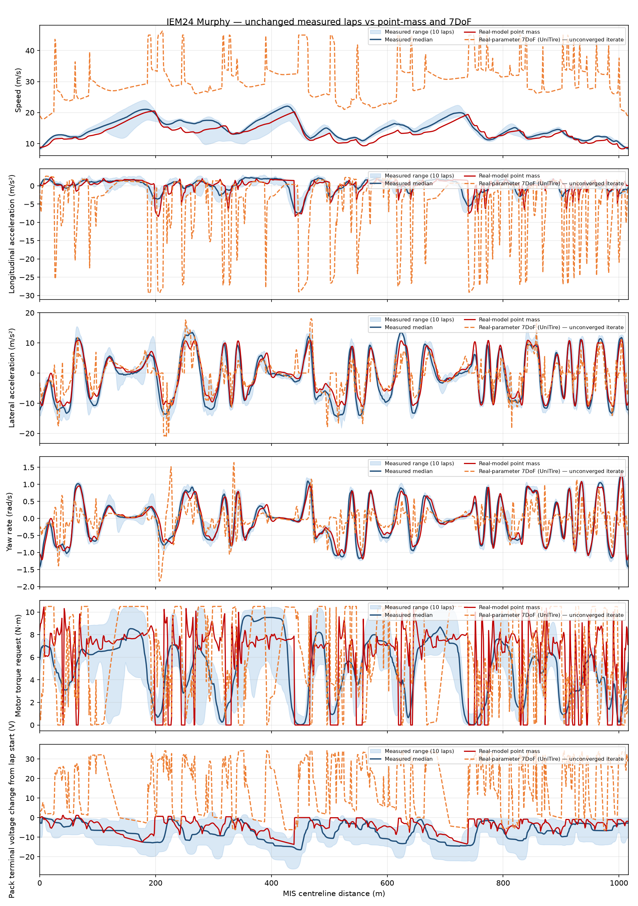

# IEM24 Murphy three-way comparison — nonvalidated historical run

> **Input provenance:** This regenerated comparison uses copies of the existing measured, point-mass, and saved 7DoF CSVs. Their SHA-256 hashes match the verified baseline inputs; this confirms file identity, not solver validity or independent reproduction. See `task-4-report.md` for hashes. The 7DoF input is unconverged and its metrics remain invalid.

> **Not validation evidence:** This archived recheck includes an unconverged
> planar OCP iterate. The 35.185 s value and all OCP-derived traces/metrics are
> illustrative only, not a valid lap-time claim. The OCP API is retired and
> unsupported; see `docs/validation/planar-ocp.md`. Retained for provenance.

Measured telemetry remains unchanged. The pack-voltage panel plots terminal-voltage change from each trace's own lap start, so all three start at zero and the mid-stint measured pack voltage offset is removed.

The point-mass run uses the real IEM24 parameter set and measured rear-drive controller configuration. The 7DoF run uses the same mass, CG, LLTD, aero, rear-only topology, battery initial SOC, and 10.5 N·m torque cap. It requires a combined-slip tire and smooth motor envelope, so its tester-fitted UniTire uses provisional surface-mu scaling informed by measured peak deceleration/cornering (not a tire re-fit), while its smooth motor envelope approximates the measured map. Parallel steering, 3.5 in/rev Narco rack travel, and 65% front brake bias are user-confirmed; steering-arm/rate and hydraulic/pedal details remain provisional. The virtual brake request is extended only as needed to reach the current hydraulic pressure cap.

- Measured flying laps: 10; median lap time 71.685 s.
- Point-mass lap: 77.561 s (converged: True).
- Planar 7DoF mesh: 1.000 m; 1018 nodes.
- Planar 7DoF iterate: 35.185 s; not converged (Maximum_Iterations_Exceeded). This is illustrative only, not a valid lap time.

The per-signal RMSE/MAE/bias/correlation metrics for each model are in `comparison_three_way_summary.json`. The shared distance-axis traces are in `comparison_three_way.csv`.
